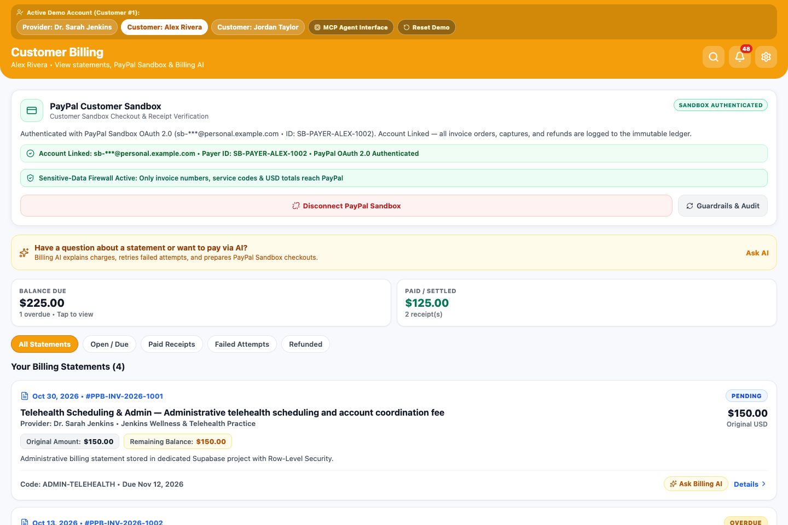
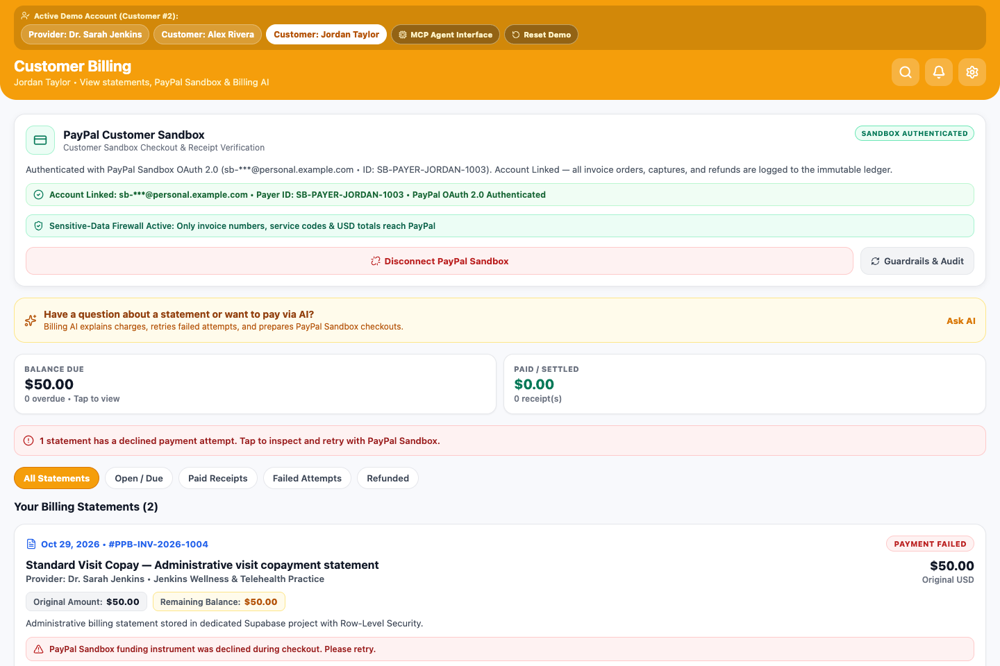
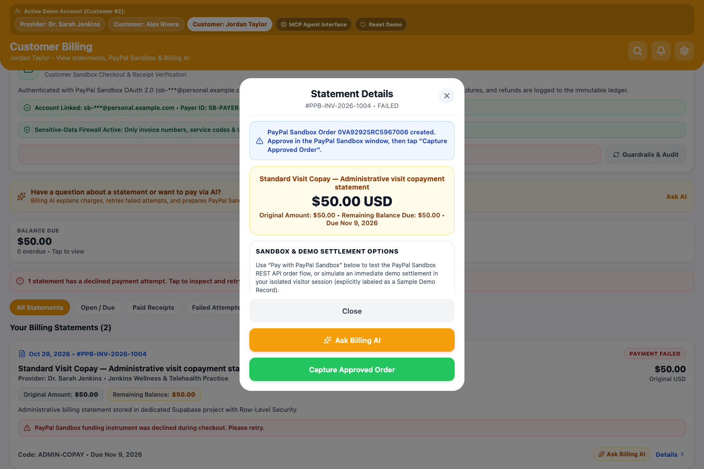
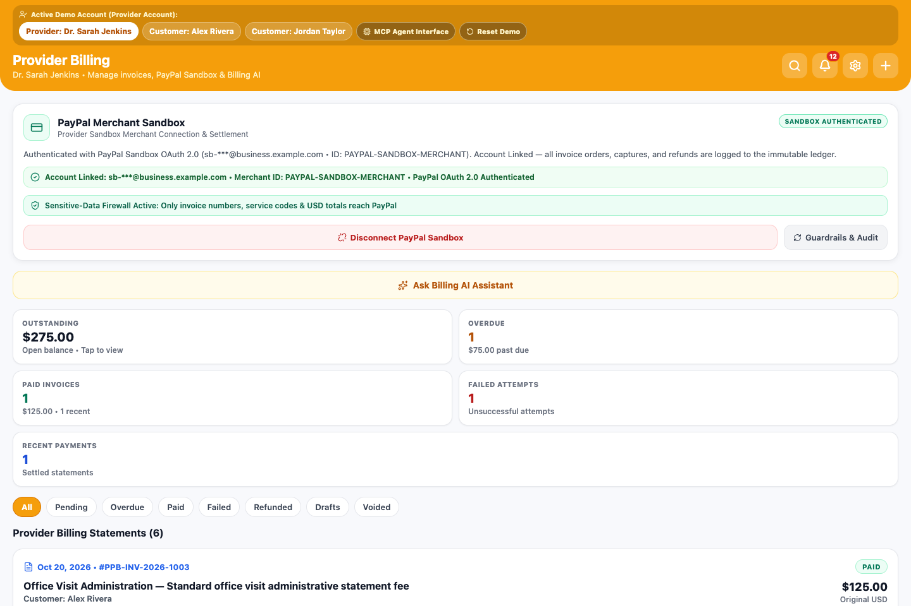
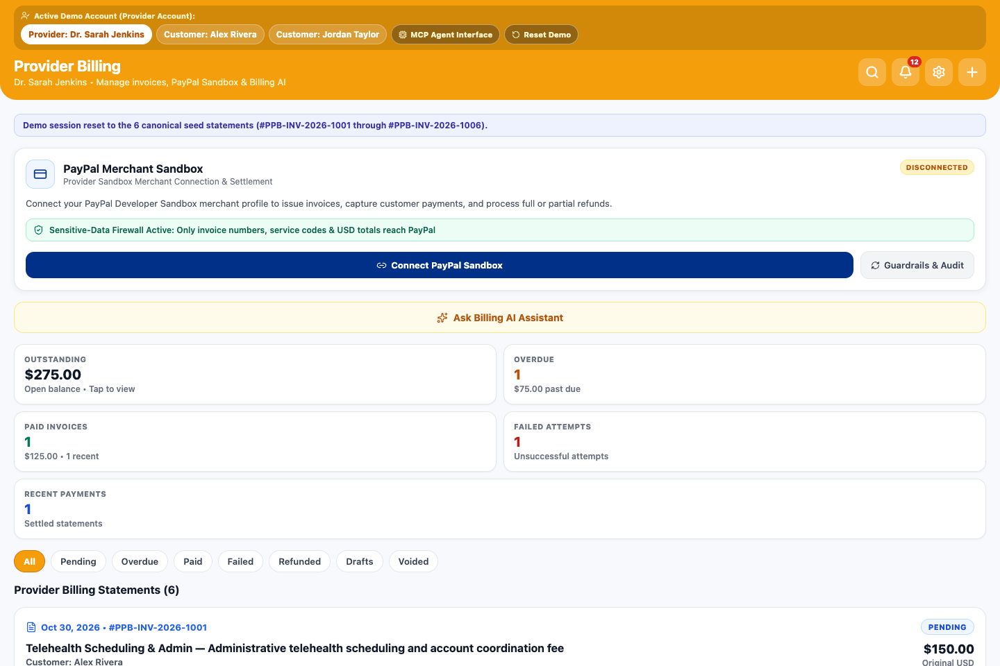
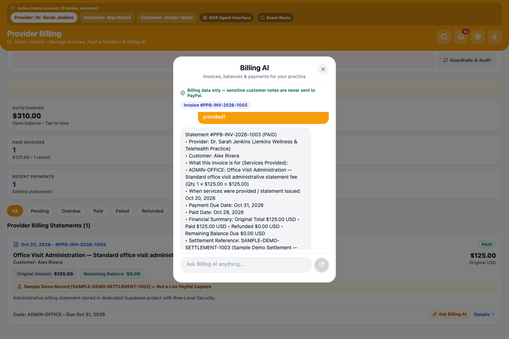
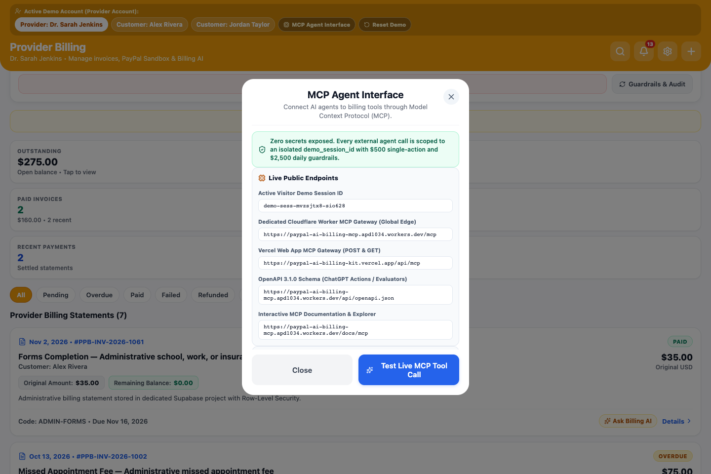
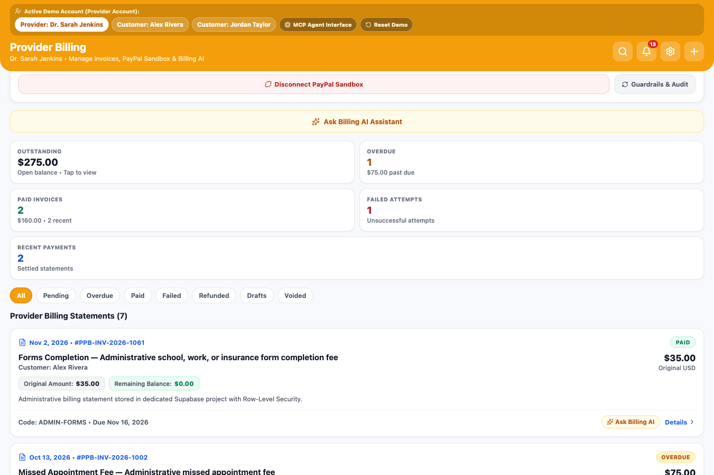
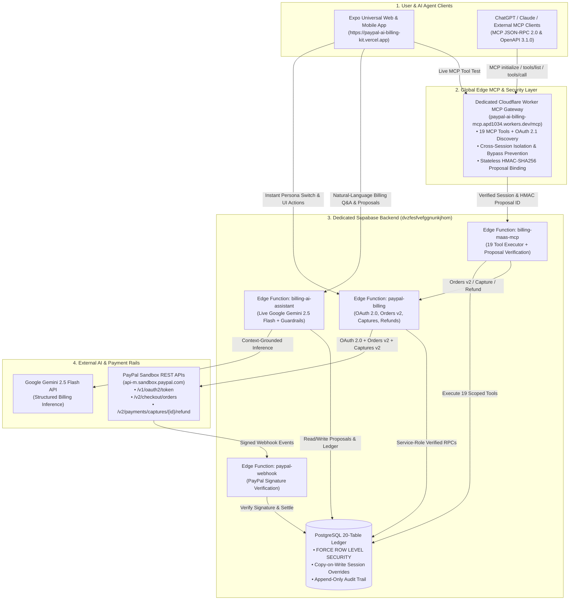

# PayPal AI Billing Kit — AI-Powered Invoicing, PayPal Sandbox Payments & MCP Agent Interface (`@paypal-ai/billing-kit`)

[](https://paypalaihackathon.devpost.com/)
[](https://paypal-ai-billing-kit.vercel.app)
[](https://paypal-ai-billing-mcp.apd1034.workers.dev/docs/mcp)
[](https://dvzfesfvefggnunkjhom.supabase.co)
[](https://ai.google.dev/)
[](./LICENSE)

> **PayPal AI Billing Kit** is a standalone, zero-PHI, full-stack conversational billing and PayPal Sandbox invoicing platform and open-source developer kit (`@paypal-ai/billing-kit`). It combines an **Expo Universal Web + Mobile UI**, **Google Gemini 2.5 Flash** in-app Billing AI, a **20-table Supabase PostgreSQL ledger** with per-visitor copy-on-write session isolation, and a dedicated **Cloudflare Worker Model Context Protocol (MCP) Agent Interface** exposing **19 financial tools** to ChatGPT, Claude, and external AI agents under strict **`AI Proposes → Human Approves → PayPal Confirms`** guardrails.

---

## Table of Contents

1. [Live Public Endpoints & Quick Links](#1-live-public-endpoints--quick-links)
2. [Problem Statement & Solution Summary](#2-problem-statement--solution-summary)
3. [Visual Walkthrough & Real Application Screenshots](#3-visual-walkthrough--real-application-screenshots)
4. [System Architecture & Data Flow](#4-system-architecture--data-flow)
5. [Core Safety & Financial Invariants](#5-core-safety--financial-invariants)
6. [19-Tool MCP Agent Interface Catalog](#6-19-tool-mcp-agent-interface-catalog)
7. [Connecting ChatGPT to the MCP Server](#7-connecting-chatgpt-to-the-mcp-server)
8. [End-to-End Conversational Prompt Playbook](#8-end-to-end-conversational-prompt-playbook)
9. [PayPal Sandbox Integration & Settlement Verification](#9-paypal-sandbox-integration--settlement-verification)
10. [Dedicated Supabase PostgreSQL Schema & Security Model](#10-dedicated-supabase-postgresql-schema--security-model)
11. [Reusable `@paypal-ai/billing-kit` TypeScript SDK](#11-reusable-paypal-aibilling-kit-typescript-sdk)
12. [Local Development, Testing & Verification Suites](#12-local-development-testing--verification-suites)
13. [Origin & Pre-Existing Work Disclosure](#13-origin--pre-existing-work-disclosure)
14. [License](#14-license)

---

## 1. Live Public Endpoints & Quick Links

| Resource | Public URL / Identifier | Status |
| :--- | :--- | :--- |
| **Public Web Application (Vercel)** | [`https://paypal-ai-billing-kit.vercel.app`](https://paypal-ai-billing-kit.vercel.app) | **LIVE (`200 OK`)** — Instant entry, zero login wall |
| **Dedicated Cloudflare Worker MCP Endpoint** | [`https://paypal-ai-billing-mcp.apd1034.workers.dev/mcp`](https://paypal-ai-billing-mcp.apd1034.workers.dev/mcp) | **LIVE (`200 OK`)** — 19 MCP tools (`2025-06-18` & `2026-07-28`) |
| **Interactive MCP Documentation & Explorer** | [`https://paypal-ai-billing-mcp.apd1034.workers.dev/docs/mcp`](https://paypal-ai-billing-mcp.apd1034.workers.dev/docs/mcp) | **LIVE (`200 OK`)** — HTML & JSON tool explorer |
| **OpenAPI 3.1.0 Specification** | [`https://paypal-ai-billing-mcp.apd1034.workers.dev/api/openapi.json`](https://paypal-ai-billing-mcp.apd1034.workers.dev/api/openapi.json) | **LIVE (`200 OK`)** — Full 19-operation OpenAPI 3.1 schema |
| **OAuth 2.0 Protected Resource Metadata (RFC 9728)** | [`https://paypal-ai-billing-mcp.apd1034.workers.dev/.well-known/oauth-protected-resource`](https://paypal-ai-billing-mcp.apd1034.workers.dev/.well-known/oauth-protected-resource) | **LIVE (`200 OK`)** |
| **OAuth 2.0 Authorization Server Metadata (RFC 8414)** | [`https://paypal-ai-billing-mcp.apd1034.workers.dev/.well-known/oauth-authorization-server`](https://paypal-ai-billing-mcp.apd1034.workers.dev/.well-known/oauth-authorization-server) | **LIVE (`200 OK`)** |
| **Public ES256 JWKS Endpoint** | [`https://paypal-ai-billing-mcp.apd1034.workers.dev/.well-known/jwks.json`](https://paypal-ai-billing-mcp.apd1034.workers.dev/.well-known/jwks.json) | **LIVE (`200 OK`)** |
| **Dedicated Supabase Project** | `dvzfesfvefggnunkjhom` (`https://dvzfesfvefggnunkjhom.supabase.co`) | **LIVE** — Isolated standalone PostgreSQL + 4 Edge Functions |

---

## 2. Problem Statement & Solution Summary

### The Problem
Service practices, independent providers, and small businesses want AI agents (both in-app assistants and external assistants like ChatGPT) to help explain statements, draft invoices, diagnose declined payments, and prepare refunds. However, giving an LLM direct write access to a payment processor introduces severe risks:
1. **Unapproved Autonomous Charges:** AI agents hallucinating amounts or charging customers without explicit human review.
2. **Sensitive Data Leakage:** Sensitive clinical, legal, or private customer notes accidentally leaking into external payment descriptions or third-party API payloads.
3. **Broken Ledger Integrity:** Voiding invoices that have already captured funds, replaying approval tokens, or confusing simulated demo state with verified payment processor captures.

### Our Solution: PayPal AI Billing Kit
**PayPal AI Billing Kit** solves these challenges with a defense-in-depth architecture:
- **Two-Stage Cryptographic Proposal Pattern (`AI Proposes → Human Approves → PayPal Confirms`):** Neither the in-app **Gemini 2.5 Flash Billing AI** nor external **ChatGPT MCP tools** can create an invoice, initiate a PayPal checkout order, void a statement, or issue a refund without first generating a guardrail-checked proposal (`billing_ai_proposals`) and receiving explicit human approval (`explicit_human_approval: true` + HMAC-SHA256 session-bound `proposal_id`).
- **Hard Monetary Velocity Guardrails:** Enforced in the TypeScript SDK, Edge Functions, Cloudflare Worker, and PostgreSQL `CHECK` constraints (`$500.00` maximum single AI action / `$2,500.00` maximum daily AI volume).
- **Sensitive-Data Firewall (`ADMIN-*` Allowlist):** Only allowlisted administrative service codes (`ADMIN-FORMS`, `ADMIN-TELEHEALTH`, `ADMIN-FOLLOWUP`, `ADMIN-OFFICE`, `ADMIN-COPAY`, `ADMIN-RECORDS`, `ADMIN-CAREPLAN`, `ADMIN-PRIORAUTH`), invoice numbers, and USD amounts ever reach PayPal APIs.
- **Per-Visitor Copy-on-Write Sandbox Isolation:** Every web visitor and external MCP session operates inside an isolated `demo_session_id` with zero-flicker preloaded persona switching (`Dr. Sarah Jenkins`, `Alex Rivera`, `Jordan Taylor`) and one-tap session reset.

---

## 3. Visual Walkthrough & Real Application Screenshots

All screenshots below are captured directly from the live production deployment (`https://paypal-ai-billing-kit.vercel.app`) via automated Playwright verification (`scripts/verify-public-vercel-e2e.mjs`).

### 3.1 Provider Dashboard (`Dr. Sarah Jenkins`) & Instant Persona Switcher


### 3.2 Customer #1 View (`Alex Rivera`) & Customer #2 View (`Jordan Taylor`)
| Customer #1: Alex Rivera (`$225.00` Balance Due) | Customer #2: Jordan Taylor (`$50.00` Failed Attempt Alert) |
| :---: | :---: |
|  |  |

### 3.3 Create Invoice Modal (`$35.00` Administrative Forms Completion) & Failed Payment Retry (`#PPB-INV-2026-1004`)
| Provider Create Invoice Modal (`ADMIN-FORMS` `$35.00`) | Customer Failed Payment Inspection & PayPal Retry (`#PPB-INV-2026-1004`) |
| :---: | :---: |
|  |  |

### 3.4 PayPal Sandbox Connection State Transitions (`SANDBOX AUTHENTICATED` ↔ `DISCONNECTED`)
| PayPal Sandbox Authenticated (`SANDBOX AUTHENTICATED` + `Account Linked`) | PayPal Sandbox Disconnected (`DISCONNECTED` + Reconnect CTA) |
| :---: | :---: |
|  |  |

### 3.5 Gemini 2.5 Flash Billing AI Assistant, 19-Tool MCP Agent Interface & Financial Audit Trail
| Gemini 2.5 Flash Billing AI Statement Explanation | 19-Tool MCP Agent Interface & Live JSON-RPC Tester |
| :---: | :---: |
|  |  |



---

## 4. System Architecture & Data Flow



---

## 5. Core Safety & Financial Invariants

1. **Strict Administrative Scope (`block_clinical_data = true`):**
   Every PayPal request and AI prompt passes through `inspectForClinicalData()` and `sanitizeAdministrativeDescription()` in `@paypal-ai/billing-kit`. Sensitive medical, clinical, or private notes are rejected before any database write or PayPal API call.
2. **Mandatory Human-in-the-Loop Approval (`require_human_approval = true`):**
   Mutating operations require a two-step workflow:
   - Step 1: Call a `proposal_only` tool (`create_invoice_proposal`, `prepare_payment_proposal`, `prepare_refund_proposal`) to run guardrail checks and generate a one-time session-bound `proposal_id`.
   - Step 2: Call the corresponding `confirmed_demo_write` tool (`create_approved_invoice`, `create_paypal_checkout_order`, `execute_approved_refund`) with `explicit_human_approval: true` and the valid `proposal_id`.
   - Any attempt to pass caller-supplied bypass flags (`bypass_guardrail`, `skip_approval`, `force`, `auto_approve`) is immediately rejected with `APPROVAL_BYPASS_PROHIBITED`.
3. **Monetary Velocity Caps (`$500.00` Single-Action / `$2,500.00` Daily):**
   Enforced across UI modals, Edge Functions, MCP tools, and PostgreSQL `CHECK` constraints (`max_single_action_minor <= 50000`, `daily_limit_minor <= 250000`). For example, proposing a `$750.00` invoice is deterministically blocked with `GUARDRAIL_SINGLE_ACTION_LIMIT_EXCEEDED`.
4. **Payment-State Protection:**
   Paid and refunded statements (`#PPB-INV-2026-1003`, `#PPB-INV-2026-1006`) cannot be voided (`PAYMENT_STATE_PROTECTION_PAID_INVOICE`); returning captured funds requires a refund proposal and refund execution.
5. **Honest Settlement Verification (`paypal_sandbox_verified` vs. `sample_demo_settlement_not_live_paypal`):**
   Every invoice, receipt, and transaction record explicitly labels whether funds were settled via a live PayPal Sandbox capture (`capture_api` / `webhook`) or an isolated demo session settlement (`seed_demo`), never fabricating PayPal Order, Capture, or Refund IDs.

---

## 6. 19-Tool MCP Agent Interface Catalog

The dedicated Cloudflare Worker (`https://paypal-ai-billing-mcp.apd1034.workers.dev/mcp`) and Supabase Edge Function (`billing-maas-mcp`) expose **19 tools** organized into 3 permission tiers:

### Tier 1: Read-Only Discovery, Receipts & Financial Inspection (10 Tools)
| # | Tool Name | Description | Key Parameters |
| :---: | :--- | :--- | :--- |
| 1 | `discover_billing_capabilities` | Discover all 19 MCP tools, `$500`/`$2,500` guardrails, demo personas, and `ADMIN-*` service catalog codes. | `demo_session_id` (optional) |
| 2 | `list_demo_customers` | List Provider (`Dr. Sarah Jenkins`) and authorized Customer accounts (`Alex Rivera`, `Jordan Taylor`). | *(none)* |
| 3 | `search_invoices` | Search and filter statements by status (`all`, `sent`, `overdue`, `paid`, `draft`, `void`, `refunded`), customer, or text query. | `query`, `status`, `customer_name`, `demo_session_id` |
| 4 | `get_invoice_details` | Retrieve full statement line items, service dates, payment attempts (including `INSTRUMENT_DECLINED` diagnostics), and plain-English explanation. | `invoice_number` (e.g., `PPB-INV-2026-1003` or `PPB-INV-2026-1004`), `demo_session_id` |
| 5 | `explain_outstanding_balances` | Compute a natural-language breakdown of pending, overdue, and paid balances for the practice or a specific customer. | `customer_name`, `demo_session_id` |
| 6 | `get_transaction_history` | Retrieve settlement captures, refunds, and declined payment attempts with verification provenance. | `invoice_number`, `demo_session_id` |
| 7 | `get_payment_receipt` | Retrieve structured payment receipt and PayPal confirmation metadata for a paid or refunded statement. | `invoice_number`, `demo_session_id` |
| 8 | `get_financial_audit_history` | Read the immutable, append-only `billing_audit_events` ledger. | `limit` (default `20`), `demo_session_id` |
| 9 | `get_paypal_sandbox_status` | Check PayPal Sandbox merchant/payer connection status and server-side PayPal REST credential configuration. | *(none)* |
| 10 | `get_business_metrics` | Calculate Provider practice and Customer KPI metrics (outstanding, overdue, paid, refunded, collection rate). | `demo_session_id` |

### Tier 2: Proposal-Only — Human Approval Required (3 Tools)
| # | Tool Name | Description | Key Parameters |
| :---: | :--- | :--- | :--- |
| 11 | `create_invoice_proposal` | Prepare a guardrail-checked (`<= $500.00`) invoice proposal and return a session-bound `proposal_id`. | `customer_name`, `service_code`, `amount_minor`, `due_date`, `demo_session_id` |
| 12 | `prepare_payment_proposal` | Prepare a customer payment checkout proposal for an unpaid or failed statement without charging autonomously. | `invoice_number`, `customer_name`, `demo_session_id` |
| 13 | `prepare_refund_proposal` | Prepare a provider refund proposal for a paid statement after verifying captured funds. | `invoice_number`, `refund_amount_minor`, `reason`, `demo_session_id` |

### Tier 3: Confirmed Financial Workflows & Demo Session Writes (6 Tools)
| # | Tool Name | Description | Key Parameters |
| :---: | :--- | :--- | :--- |
| 14 | `create_approved_invoice` | Execute an approved invoice creation inside the isolated `demo_session_id`. | `proposal_id`, `explicit_human_approval: true`, `demo_session_id` |
| 15 | `create_paypal_checkout_order` | Create a PayPal Sandbox checkout order (`POST /v2/checkout/orders`) for an unpaid statement or payment proposal. | `proposal_id`, `invoice_number`, `explicit_human_approval: true`, `demo_session_id` |
| 16 | `capture_paypal_checkout_order` | Capture an approved PayPal Sandbox order (`order_id`) or settle an invoice in the isolated demo session (`allow_demo_settlement_fallback: true`). | `invoice_number`, `order_id`, `allow_demo_settlement_fallback`, `explicit_human_approval: true`, `demo_session_id` |
| 17 | `execute_approved_refund` | Execute an approved refund for a paid statement (`invoice_number` or `proposal_id` from `prepare_refund_proposal`). | `proposal_id`, `invoice_number`, `amount_minor`, `explicit_human_approval: true`, `demo_session_id` |
| 18 | `void_unpaid_invoice` | Void an unpaid Draft, Sent, or Overdue statement (`$0.00` remaining balance; blocked on paid/refunded invoices). | `invoice_number`, `reason`, `explicit_human_approval: true`, `demo_session_id` |
| 19 | `reset_demo_session` | Reset an isolated `demo_session_id`, restoring the 6 canonical seed statements (`#PPB-INV-2026-1001` through `#PPB-INV-2026-1006`). | `demo_session_id` |

---

## 7. Connecting ChatGPT to the MCP Server

You can connect ChatGPT to the standalone PayPal AI Billing Kit using **ChatGPT MCP Connectors** (Developer Mode) or **ChatGPT Custom GPT Actions** (OpenAPI 3.1.0):

### Option A: ChatGPT MCP Connector (Recommended)
1. Open ChatGPT (`https://chatgpt.com`) → **Settings** → **Connectors** (or **Apps & Connectors** → **Create / Add MCP Connector**).
2. Enter the following details:
   - **Name:** `PayPal AI Billing Kit`
   - **MCP Server URL:** `https://paypal-ai-billing-mcp.apd1034.workers.dev/mcp`
   - **Authentication:** `None (Public Demo Sandbox)` or `OAuth 2.0` (auto-discovered via `/.well-known/oauth-protected-resource` and Dynamic Client Registration at `/oauth/register`).
3. Click **Connect / Refresh Tools** to discover all **19 tools**.
4. **If tools do not appear immediately:** Click **Refresh** in the connector settings or start a new ChatGPT conversation with the `PayPal AI Billing Kit` connector enabled.

### Option B: ChatGPT Custom GPT Actions (OpenAPI 3.1.0 Fallback)
1. In ChatGPT → **Explore GPTs** → **Create** → **Configure** → **Actions** → **Import from URL**.
2. Paste:
   ```text
   https://paypal-ai-billing-mcp.apd1034.workers.dev/api/openapi.json
   ```
3. All 19 operations (`/api/tools/<tool_name>`) will import automatically with zero manual schema editing.

---

## 8. End-to-End Conversational Prompt Playbook

Once connected in ChatGPT (or inside the in-app **Billing AI Assistant**), test the complete financial lifecycle with these natural-language prompts:

1. **Inspect Pending Statements:**
   > *"Show me Alex Rivera's pending invoices in session `chatgpt-demo-01`."*
   - Invokes `search_invoices` (`customer_name: "Alex Rivera"`, `demo_session_id: "chatgpt-demo-01"`).
2. **Diagnose a Failed Payment Attempt:**
   > *"Explain Jordan Taylor's failed payment on statement `#PPB-INV-2026-1004`."*
   - Invokes `get_invoice_details` (`invoice_number: "PPB-INV-2026-1004"`) → explains the `$50.00` `ADMIN-COPAY` statement and the `INSTRUMENT_DECLINED` payment attempt where `$0.00` was captured.
3. **Propose & Approve a New `$35.00` Invoice (`AI Proposes → Human Approves`):**
   > *"Propose a `$35.00` Administrative Forms Completion (`ADMIN-FORMS`) invoice for Alex Rivera in session `chatgpt-demo-01`, then create the approved invoice after I confirm."*
   - Step 1: Invokes `create_invoice_proposal` → returns session-bound `proposal_id` and guardrail check (`$35.00 <= $500.00`).
   - Step 2: Invokes `create_approved_invoice` (`proposal_id`, `explicit_human_approval: true`) → creates the new statement.
4. **Test the `$500.00` Monetary Velocity Guardrail:**
   > *"Try to create a `$750.00` invoice proposal for Alex Rivera."*
   - Invokes `create_invoice_proposal` (`amount_minor: 75000`) → deterministically blocked by `GUARDRAIL_SINGLE_ACTION_LIMIT_EXCEEDED`.
5. **Prepare Payment, Settle Statement & Retrieve Receipt:**
   > *"Prepare a payment proposal for Jordan Taylor's `#PPB-INV-2026-1004` (`$50.00`) in session `chatgpt-demo-01`, settle it, and show me the payment receipt."*
   - Invokes `prepare_payment_proposal` → `create_paypal_checkout_order` / `capture_paypal_checkout_order` → `get_payment_receipt`.
6. **Prepare & Execute a Provider Refund:**
   > *"Prepare a refund proposal for paid statement `#PPB-INV-2026-1003` (`$125.00`) in session `chatgpt-demo-01`, execute the approved refund, and show the updated financial audit trail."*
   - Invokes `prepare_refund_proposal` → `execute_approved_refund` → `get_financial_audit_history`.
7. **Reset the Isolated Demo Session:**
   > *"Reset demo session `chatgpt-demo-01` back to the 6 canonical statements."*
   - Invokes `reset_demo_session` (`demo_session_id: "chatgpt-demo-01"`).

---

## 9. PayPal Sandbox Integration & Settlement Verification

The `paypal-billing` and `paypal-webhook` Supabase Edge Functions implement genuine PayPal Sandbox REST API v2 integration against `https://api-m.sandbox.paypal.com`:
- **OAuth 2.0 Client Credentials (`POST /v1/oauth2/token`):** Exchanges `PAYPAL_SANDBOX_CLIENT_ID` and `PAYPAL_SANDBOX_CLIENT_SECRET` (`Default Application`, `App ID: APP-5SK74342S6474230W`) for a live Sandbox bearer token and distinguishes **`SANDBOX AUTHENTICATED`** (`Account Linked`, `paypal_verified: true`) from unverified demo profiles (**`DEMO PROFILE AVAILABLE`** / `Sandbox Configuration Missing`) and **`DISCONNECTED`**.
- **PayPal Orders v2 (`POST /v2/checkout/orders`):** Creates an order with `intent: "CAPTURE"`, `custom_id: <invoice_id>`, `invoice_id: <invoice_number>-<timestamp>`, and sanitized `ADMIN-*` item metadata, returning the `orderId` and buyer `approve` link.
- **PayPal Order Capture (`POST /v2/checkout/orders/{id}/capture`):** Captures buyer-approved orders and invokes `billing_apply_verified_capture` (`service_role` only) to record the `paypal_capture_id`, seller fee breakdown, and receipt.
- **PayPal Captures v2 Refund (`POST /v2/payments/captures/{id}/refund`):** Issues full or partial refunds against verified PayPal capture IDs and updates `billing_refunds` and `billing_invoices`.
- **PayPal Webhook Signature Verification (`POST /v1/notifications/verify-webhook-signature`):** Rejects unsigned or spoofed webhook payloads (`400 MISSING_SIGNATURE_HEADERS`) before any state change.

### Verified End-to-End Real PayPal Sandbox Transaction (`evidence/04_live_paypal_sandbox_transaction.json`)
| Artifact / Field | Verified Value |
| :--- | :--- |
| **PayPal REST Application** | `Default Application` (`APP-5SK74342S6474230W`) |
| **Isolated Session ID** | `live-sbx-1793655303922` |
| **Created Statement** | `#PPB-INV-2026-1057` (`562b3029-9a2c-452b-8ee8-d04939e336bf`, `$35.00 USD`, `ADMIN-FORMS`) |
| **Payment Proposal ID** | `6696130a-4d92-4753-bc71-34bc04340b5b.b554bcdcbb79dc7f` |
| **Real PayPal Sandbox Order ID** | `7FA47897KM5938009` (`PAYER_ACTION_REQUIRED` → `COMPLETED`) |
| **Real PayPal Sandbox Capture ID** | `5HM71086SR568352C` (`COMPLETED`, `$35.00 USD`, `2026-11-02T21:53:02.952534+00:00`) |
| **Real PayPal Sandbox Refund ID** | `2EM77813GU330222M` (`COMPLETED`, `$35.00 USD`, `2026-11-02T21:53:07.54377+00:00`) |

---

## 10. Dedicated Supabase PostgreSQL Schema & Security Model

The standalone Supabase project (`dvzfesfvefggnunkjhom`) enforces **`FORCE ROW LEVEL SECURITY`** across **20 `billing_*` tables**:
1. `billing_accounts` — Fictional Provider & Customer directory profiles (`Dr. Sarah Jenkins`, `Alex Rivera`, `Jordan Taylor`, `Dr. Marcus Vance`).
2. `billing_organizations` — Practice/merchant entities.
3. `billing_org_members` — Organization membership & role (`owner`, `billing_admin`, `staff`).
4. `billing_customer_links` — Authorized Provider ↔ Customer billing relationships.
5. `billing_merchant_configs` — Merchant PayPal Sandbox configuration metadata.
6. `billing_account_connections` — Per-user PayPal Sandbox connection status (`connected` / `revoked`).
7. `billing_connection_secrets` — Server-only OAuth token cache (`service_role` only).
8. `billing_platform_secrets` — Server-only encrypted platform secret store (`service_role` only; `anon` and `authenticated` access strictly revoked).
9. `billing_service_catalog` — Allowlisted administrative billing codes (`ADMIN-*`).
10. `billing_invoices` — Canonical and session-scoped statements with generated `balance_due_minor`.
11. `billing_invoice_items` — Line items linked to `billing_invoices`.
12. `billing_demo_session_overrides` — Copy-on-write per-visitor (`demo_session_id`) state overrides so concurrent evaluators never overwrite each other's canonical seed statements.
13. `billing_payment_attempts` — PayPal Orders v2 checkout lifecycle & failure diagnostics (`INSTRUMENT_DECLINED`).
14. `billing_transactions` — Settlement ledger with `verified_via` (`capture_api`, `order_lookup`, `webhook`, `seed_demo`).
15. `billing_refunds` — Refund ledger records.
16. `billing_webhook_events` — Idempotent webhook event log (`service_role` only).
17. `billing_audit_events` — Immutable financial audit log (updates and deletes blocked by database trigger).
18. `billing_ai_settings` — Per-user AI guardrails with locked `CHECK` constraints (`$500.00` / `$2,500.00`).
19. `billing_ai_sessions` — Conversational Billing AI session history.
20. `billing_ai_proposals` — Database-backed AI action proposals (`pending` → `approved` → `executed` / `rejected` / `blocked`).

---

## 11. Reusable `@paypal-ai/billing-kit` TypeScript SDK

Located in [`packages/paypal-billing-kit`](./packages/paypal-billing-kit), the reusable SDK can be imported into any TypeScript, React Native, Next.js, or Node/Deno project:

```typescript
import {
  inspectForClinicalData,
  sanitizeAdministrativeDescription,
  evaluateAiFinancialGuardrail,
  extractPayPalWebhookHeaders,
  normalizePayPalWebhookEvent,
} from '@paypal-ai/billing-kit';

// 1. Enforce Sensitive-Data Firewall before calling PayPal
const firewall = inspectForClinicalData({
  invoice_number: 'PPB-INV-2026-1001',
  service_code: 'ADMIN-FORMS',
  amount_minor: 3500,
});
// firewall.allowed === true

// 2. Evaluate $500 single-action / $2,500 daily AI guardrails
const guardrail = evaluateAiFinancialGuardrail({
  amountMinor: 3500,
  policy: {
    maxSingleActionMinor: 50000,
    dailyLimitMinor: 250000,
    usedTodayMinor: 0,
  },
});
// guardrail.passed === true, guardrail.humanApprovalRequired === true
```

---

## 12. Local Development, Testing & Verification Suites

### Quick Start
```bash
git clone <repository-url>
cd PayPal-AI-Billing-Kit
npm install

# Start local Expo Web & Mobile development server on port 8081
npx expo start --web --port 8081
```

### Automated Verification Commands
```bash
# 1. TypeScript static typecheck
npm run typecheck

# 2. Jest unit & component regression suite (11/11 tests)
npm test -- --watchAll=false

# 3. Live 30-check Cloudflare Worker MCP Agent Interface & 19-tool workflow verifier
node scripts/verify-maas-mcp.mjs

# 4. Live 20-check Gemini 2.5 Flash Billing AI & Backend Security audit suite
node scripts/verify-security-and-ai.mjs

# 5. Full 15-check Playwright E2E browser verification + screenshot generator
node scripts/verify-public-vercel-e2e.mjs

# 6. Repository secret & isolation scanner
npm run scan:secrets
```

---

## 13. Origin & Pre-Existing Work Disclosure

In accordance with official PayPal AI Hackathon transparency rules:
- **Adapted UI Foundation:** Foundational React Native card primitives and modal shell patterns originated in the owner's *Health eRecords 2.0* project and were extracted, stripped of all clinical/medical modules, and refactored into a standalone administrative billing kit.
- **Newly Built for the PayPal AI Hackathon 2026:**
  - Standalone multi-persona Expo Web/Mobile application (`app/index.tsx`, `components/billing/*`) with zero-flicker preloaded persona switching (`Dr. Sarah Jenkins`, `Alex Rivera`, `Jordan Taylor`), `PayPalConnectCard` Connected/Disconnected state management, failed payment retry workflows (`#PPB-INV-2026-1004`), and one-tap session reset.
  - Independent 20-table Supabase PostgreSQL database (`dvzfesfvefggnunkjhom`) with `FORCE ROW LEVEL SECURITY` and copy-on-write visitor session isolation (`billing_demo_session_overrides`).
  - Four dedicated Supabase Edge Functions (`paypal-billing`, `paypal-webhook`, `billing-ai-assistant` powered by live `gemini-2.5-flash`, and `billing-maas-mcp`).
  - Dedicated Cloudflare Worker **MCP Agent Interface** (`https://paypal-ai-billing-mcp.apd1034.workers.dev/mcp`) exposing **19 MCP tools** with OAuth 2.1 discovery, OpenAPI 3.1.0 schema generation, and stateless HMAC-SHA256 proposal binding.
  - Reusable `@paypal-ai/billing-kit` TypeScript SDK (`packages/paypal-billing-kit`) and automated verification suites (`__tests__/paypalBillingKit.test.tsx`, `scripts/verify-maas-mcp.mjs`, `scripts/verify-security-and-ai.mjs`, `scripts/verify-public-vercel-e2e.mjs`).

---

## 14. License

Released under the [MIT License](./LICENSE).
