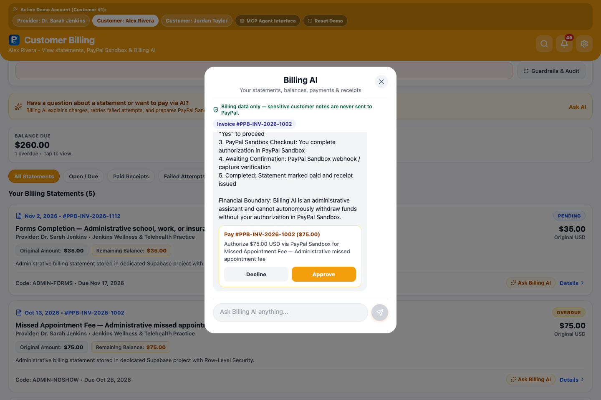
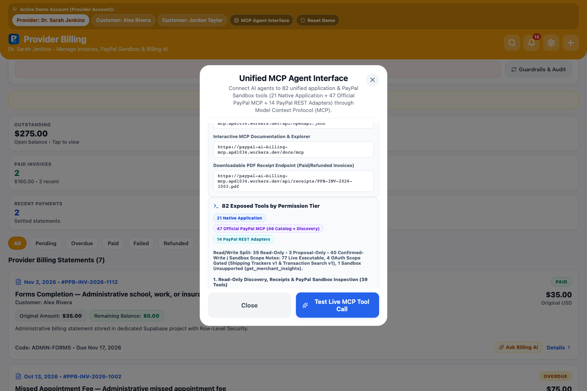
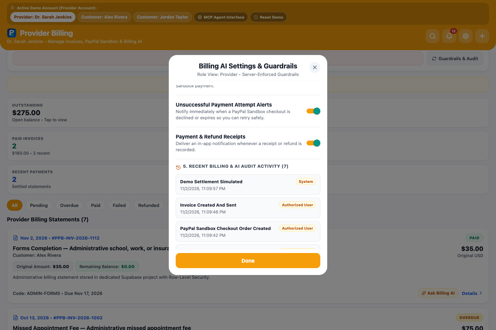
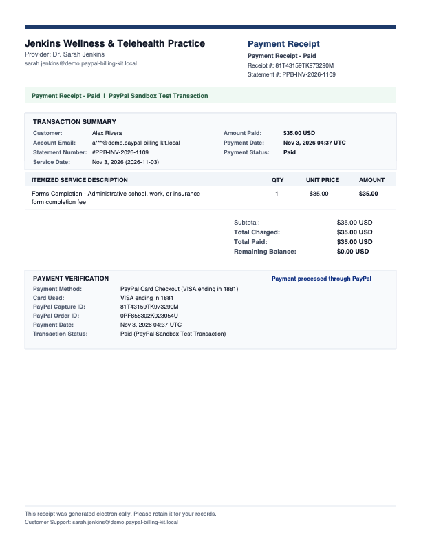
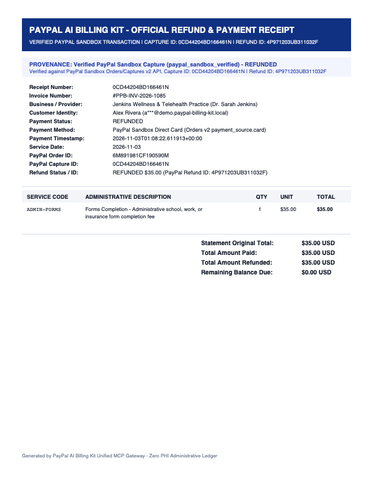
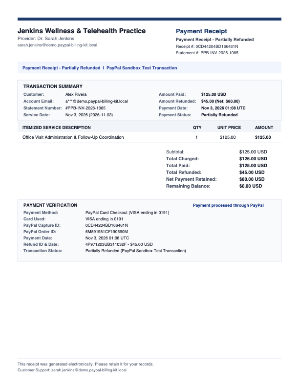
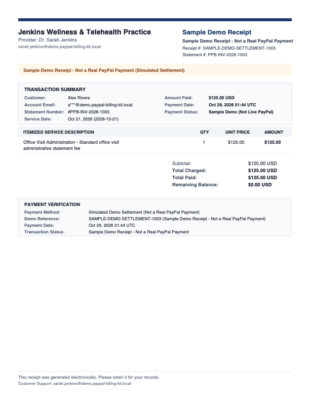
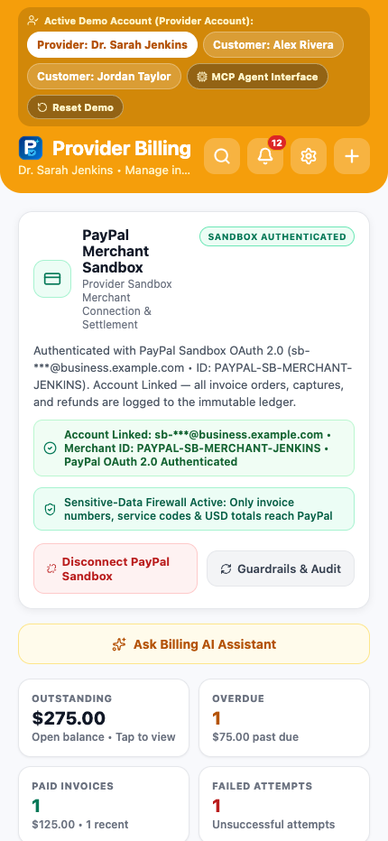
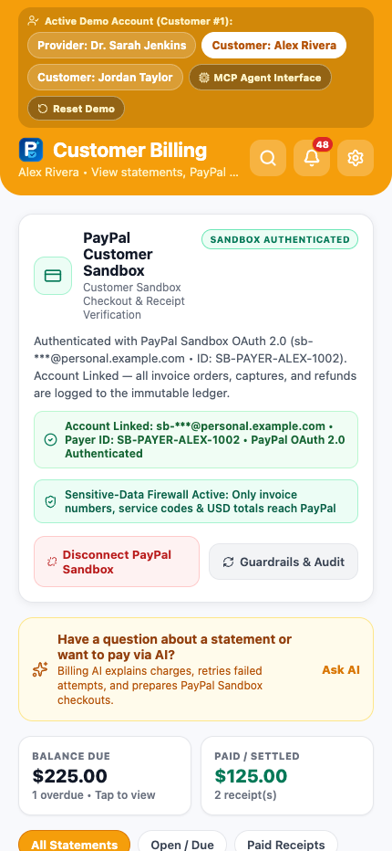

# PayPal AI Billing Kit (`v1.9.0`)

**AI-Powered Invoicing, Mistake-Recovery Workflows, Conversational Authorization, Automated Server-Side Sandbox Card Checkout, Merchant-Branded PDF Receipts & Unified 82-Tool Model Context Protocol (MCP) Gateway for PayPal Sandbox.**

[](./LICENSE)
[](https://paypal-ai-billing-kit.vercel.app)
[](https://paypal-ai-billing-mcp.apd1034.workers.dev/mcp)
[](https://paypal-ai-billing-mcp.apd1034.workers.dev/api/openapi.json)
[](./evidence/05_gemini_3_5_flash_lite_migration.json)

---

## Live Public Endpoints

| Endpoint | Public URL | Purpose |
| :--- | :--- | :--- |
| **Web Application (Vercel)** | `https://paypal-ai-billing-kit.vercel.app` | Interactive Provider & Customer Billing Dashboard (Desktop & Mobile Web, zero login required) |
| **Dedicated Unified MCP Gateway (Cloudflare Worker)** | `https://paypal-ai-billing-mcp.apd1034.workers.dev/mcp` | Primary JSON-RPC 2.0 MCP Server (`POST` & `GET`) exposing **82 unified tools** for ChatGPT MCP, Claude Desktop, and MCP Inspector |
| **Supabase MCP Edge Backend** | `https://dvzfesfvefggnunkjhom.supabase.co/functions/v1/billing-maas-mcp` | Direct Supabase Edge Function JSON-RPC 2.0 MCP server with identical 82-tool registry and SHA-256 schema parity |
| **Vercel MCP Mirror** | `https://paypal-ai-billing-kit.vercel.app/api/mcp` | Mirror JSON-RPC 2.0 MCP endpoint proxying to the unified 82-tool gateway |
| **OpenAPI 3.1.0 Spec** | `https://paypal-ai-billing-mcp.apd1034.workers.dev/api/openapi.json` | Machine-readable OpenAPI 3.1.0 schema for ChatGPT Custom GPT Actions |
| **Interactive MCP Docs** | `https://paypal-ai-billing-mcp.apd1034.workers.dev/docs/mcp` | Human-readable MCP documentation and `curl` examples |
| **Downloadable PDF Receipt API (Sample Link)** | `https://paypal-ai-billing-mcp.apd1034.workers.dev/api/receipts/PPB-INV-2026-1003.pdf` | Sample PDF 1.4 receipt (`#PPB-INV-2026-1003`) for instant viewing; every PayPal Sandbox transaction dynamically generates its own unique receipt via `/api/receipts/:invoice_number.pdf` (`Content-Type: application/pdf`) |

---

## Product Introduction & Value Proposition

**PayPal AI Billing Kit (`@paypal-ai/billing-kit`, `v1.9.0`)** is a standalone, open-source AI billing, checkout, mistake-recovery, and Model Context Protocol (MCP) platform built for the **PayPal AI Hackathon 2026**.

Service practices and small businesses frequently lose revenue or customer trust when administrative billing errors occur—such as declined payment attempts, duplicate or mis-coded statements, unclear charge descriptions, or partial refunds. At the same time, connecting autonomous AI agents directly to payment APIs introduces financial and privacy risks if agents can mutate balances without velocity caps, audit trails, or data firewalls.

**PayPal AI Billing Kit solves both challenges in one unified architecture:**
1. **Multi-Role Interactive Billing Dashboard (`Provider` & `Customer`):** Instant, zero-friction switching between **Provider (`Dr. Sarah Jenkins` — Jenkins Wellness & Telehealth Practice)** and **Customers (`Alex Rivera` & `Jordan Taylor`)** with per-visitor session isolation (`X-Demo-Session-Id`).
2. **Gemini 3.5 Flash-Lite Billing AI Assistant (`gemini-3.5-flash-lite`):** Explains statement line items, diagnoses declined payment attempts, prepares cryptographic human-approval proposals (`PPB-PROP-1...`), and executes authorized natural-language billing instructions within strict monetary guardrails (`$500.00` single action / `$2,500.00` daily cumulative limit).
3. **Unified 82-Tool MCP Gateway (`21 Native` + `47 Official PayPal MCP` + `14 PayPal Sandbox REST Adapters`):** Gives ChatGPT, Claude Desktop, and custom AI agents a single JSON-RPC 2.0 connection (`2025-06-18`) that unifies application-level billing workflows with PayPal's official 46-tool MCP catalog and extended PayPal Sandbox REST APIs.
4. **Real End-to-End PayPal Sandbox Payments, Direct Card Checkout & Refunds:** Supports both interactive PayPal Wallet Checkout (`PAYER_ACTION_REQUIRED` buyer approval) and automated server-side **PayPal Sandbox Direct Card Checkout (`Orders v2 payment_source.card`)** using allowlisted Sandbox test card profiles (`visa_sandbox`, `mastercard_sandbox`, `amex_sandbox`, plus decline test profiles) for complete `Invoice → Order → Capture → PDF Receipt → Refund` verification.
5. **Professional Merchant-Branded PDF 1.4 Receipts:** Dynamically generates downloadable, merchant-first PDF receipts (`Jenkins Wellness & Telehealth Practice`, `"Payment processed through PayPal"`) for every paid, partially refunded, or fully refunded statement while strictly refusing unpaid invoices (`RECEIPT_UNAVAILABLE_UNPAID_INVOICE`).

---

## Playable Demo Videos (`docs/videos/`)

All recorded walkthrough videos are H.264 MP4 (`1440x900`, `yuv420p`, `30fps`) captured directly against the live production deployment (`https://paypal-ai-billing-kit.vercel.app`) and verified with `ffprobe`.

| Video Clip | Duration | Resolution | Description |
| :--- | :--- | :--- | :--- |
| [**`01-full-product-walkthrough-v1.9.0.mp4`**](./docs/videos/01-full-product-walkthrough-v1.9.0.mp4) | `47.2s` | `1440x900` | **Complete End-to-End Product Walkthrough (`v1.9.0`):** Provider dashboard, `$35.00 Forms Completion` invoice creation, Customer perspectives (`Alex Rivera` & `Jordan Taylor`), failed payment inspection (`#PPB-INV-2026-1004`), live PayPal Sandbox Direct Card Checkout (`VISA •••• 1881`), PDF receipt verification, Guardrails & Audit Trail modal, and 82-Tool Unified MCP Agent Interface live test. |
| [**`02-gemini-ai-billing-and-proposals.mp4`**](./docs/videos/02-gemini-ai-billing-and-proposals.mp4) | `16.2s` | `1440x900` | **Gemini 3.5 Flash-Lite Billing AI & Proposals:** Asking Billing AI to explain statement `#PPB-INV-2026-1003` and preparing a human-approval payment checkout proposal for `#PPB-INV-2026-1002 ($75.00)`. |
| [**`03-unified-82-tool-mcp-gateway.mp4`**](./docs/videos/03-unified-82-tool-mcp-gateway.mp4) | `14.0s` | `1440x900` | **Unified 82-Tool MCP Gateway:** Exploring the 82-tool MCP Agent Interface modal (`21 Native` + `47 Official PayPal MCP` + `14 PayPal REST Adapters`), permission tiers, and live JSON-RPC `get_invoice_details` execution. |
| [**`04-paypal-sandbox-card-payment-refund-receipt.mp4`**](./docs/videos/04-paypal-sandbox-card-payment-refund-receipt.mp4) | `34.0s` | `1440x900` | **PayPal Sandbox Direct Card Checkout, PDF Receipt & Refund:** Creating a `$35.00` invoice, capturing payment via server-side PayPal Sandbox Direct Card Checkout (`Order → Capture`), verifying the downloadable PDF receipt, and executing a live PayPal Sandbox Refund (`Capture → Refund`). |

> See [`docs/MEDIA_AUDIT_MANIFEST.md`](./docs/MEDIA_AUDIT_MANIFEST.md) and [`evidence/media-audit-manifest.json`](./evidence/media-audit-manifest.json) for the complete media inventory and verification metadata.

---

## Current Verified Feature Inventory (`v1.9.0`)

1. **Unified 82-Tool MCP Gateway (`https://paypal-ai-billing-mcp.apd1034.workers.dev/mcp`):**
   - **21 Native Application Tools (`source: "native_application"`):** Customer lookup, invoice search, balance explanation, transaction history, structured + binary PDF receipts (`get_payment_receipt`, `generate_receipt_pdf`), session-isolated audit logs, business metrics, proposal creation, real PayPal Sandbox wallet & card order creation/capture/refund, unpaid invoice voiding, and conversational command execution.
   - **47 Official PayPal MCP Tools (`source: "official_paypal_mcp"`):** `paypal_discover_official_mcp` plus all **46 official PayPal MCP tools** registered by their exact official names (`18` read-only, `28` write).
   - **14 PayPal Sandbox REST-to-MCP Adapter Tools (`source: "paypal_rest_adapter"`):** `paypal_get_order`, `paypal_get_refund`, `paypal_list_invoices`, `paypal_generate_invoice_number`, `paypal_list_disputes`, `paypal_check_card_eligibility`, `execute_sandbox_card_payment`, `run_sandbox_card_lifecycle_test`, `update_plan`, `paypal_authorize_order`, `paypal_list_webhooks`, `paypal_list_webhook_event_types`, `paypal_list_invoice_templates`, and `paypal_create_vault_setup_token`.
   - **Permission Tiers:** `39` `read_only`, `3` `proposal_only`, and `40` `confirmed_demo_write`.
2. **Automated Server-Side PayPal Sandbox Direct-Card Checkout (`Orders v2 payment_source.card`):**
   - Alongside standard PayPal Wallet Checkout (`PAYER_ACTION_REQUIRED` → buyer approval URL) and explicitly labeled Demo Settlement Simulation, supports server-side PayPal Sandbox card payments using allowlisted developer test card profiles (`visa_sandbox`, `mastercard_sandbox`, `amex_sandbox`, `decline_refused`, `decline_expired`, `decline_insufficient_funds`) for automated `Order → Capture → Receipt → Refund` verification without exposing or accepting raw card numbers (`RAW_CARD_CREDENTIALS_FORBIDDEN`).
3. **8-State Payment-Attempt Classification & Session-Isolated Audit Trail:**
   - Distinguishes `awaiting_buyer_approval`, `approval_required` (`ORDER_NOT_APPROVED`), `payment_declined`, `buyer_canceled`, `authorized`, `captured`, `refunded`, and `processing_error` so premature capture attempts never inflate declined-card metrics.
   - Enforces strict session and role isolation on `get_financial_audit_history` (`canonical_seed` vs `session_private`).
4. **Dual Authorization Model (Cryptographic Proposals + Conversational Authorization):**
   - **HMAC-SHA256 Proposal Tokens (`PPB-PROP-1...`):** Server-persisted in `public.billing_ai_action_proposals` with 30-minute expiration, parameter binding, and single-use consumption.
   - **Explicit Conversational Authorization (`evaluateConversationalAuthorization`):** Direct user instructions (e.g., *"Create a $35 invoice for Alex Rivera for immunization"*, *"Pay Alex Rivera's $35 invoice"*, *"Refund $20 on invoice PPB-INV-2026-1003"*, *"Void unpaid invoice PPB-INV-2026-1001"*) execute immediately within `$500.00` single-action and `$2,500.00` daily guardrails, while capability inquiries (*"Can you refund invoices?"*) and hypothetical questions (*"What would happen if I paid?"*) return explanations or previews without mutating records.
5. **Gemini 3.5 Flash-Lite Integration (`gemini-3.5-flash-lite`):**
   - Proactively migrated from `gemini-2.5-flash` to `gemini-3.5-flash-lite` ahead of Google AI Studio's December 1, 2026 auto-redirect deadline.
   - Uses `thinkingConfig: { thinkingLevel: "MEDIUM" }`, preserves `thoughtSignature` across multi-turn `functionCall` / `functionResponse` turns, and supports `mediaResolution: "MEDIA_RESOLUTION_HIGH"`.
6. **Professional Merchant-Branded PDF 1.4 Receipts:**
   - Dynamically generates a unique, merchant-first downloadable PDF receipt (`GET /api/receipts/:invoice_number.pdf`) and base64-encoded PDF inside `get_payment_receipt` and `generate_receipt_pdf` for every paid or refunded statement (`#PPB-INV-2026-1003.pdf` is provided as a sample PDF for quick viewing, while all live PayPal Sandbox transactions dynamically generate their own unique receipt with their real PayPal Order, Capture, and Refund IDs).
   - Displays **Jenkins Wellness & Telehealth Practice** (`Provider: Dr. Sarah Jenkins`), state-specific headers (`Payment Receipt - Paid`, `Payment & Refund Receipt - Refunded`, `Payment Receipt - Partially Refunded`, `Sample Demo Receipt - Not a Real PayPal Payment`), card brand & last 4 digits, `"Payment processed through PayPal"` attribution, and `"This receipt was generated electronically. Please retain it for your records."` footer.

---

## Official PayPal MCP Integration, REST Execution Bridge & Sandbox Limitations

PayPal's official remote MCP server (`https://mcp.sandbox.paypal.com/sse`, powered by `@paypal/mcp@1.8.1` and `@paypal/agent-toolkit@1.11.0`) advertises **46 tools**. However, in serverless Edge runtimes (Deno / Cloudflare Workers), `@paypal/agent-toolkit`'s internal `axios` client passes `cache: "default"` to `fetch()`, which throws a runtime `TypeError` on Edge V8 isolates.

To provide reliable access through a single MCP connection, our gateway (`supabase/functions/billing-maas-mcp/index.ts` and `worker/src/index.ts`) registers all **46 official PayPal MCP tools** by their exact official names and executes them through a verified **PayPal Sandbox REST v1/v2/v3 execution bridge** (`https://api-m.sandbox.paypal.com`) using server-side OAuth 2.0 client-credentials authentication (`APP-5SK74342S6474230W`).

### Honest Execution Classification Across All 46 Official PayPal MCP Tools

We do **not** claim all 46 official tools execute unconditionally in Sandbox. Live individual verification (`npm run verify:full-paypal-mcp`, recorded in [`evidence/full-paypal-mcp-verification.json`](./evidence/full-paypal-mcp-verification.json)) establishes the exact operational breakdown:

| Verification Status | Tool Count | Meaning & Exact Tools |
| :--- | :--- | :--- |
| **`PASS_REST_ADAPTER` (Fully Executed Live on PayPal Sandbox)** | **`35` / 46** | **Full end-to-end live execution (`HTTP 200/201/204`) against `https://api-m.sandbox.paypal.com`:** `create_invoice`, `create_recurring_series`, `activate_recurring_series`, `get_recurring_series`, `cancel_recurring_series`, `delete_recurring_series`, `list_invoices`, `get_invoice`, `send_invoice`, `send_invoice_reminder`, `cancel_sent_invoice`, `delete_invoice`, `setup_invoice_auto_reminders`, `update_invoice_auto_reminder`, `search_invoicing`, `update_invoicing`, `cancel_invoice_auto_reminder`, `generate_invoice_qr_code`, `generate_invoice_number`, `record_payment_for_invoice`, `record_refund_for_invoice`, `create_product`, `list_products`, `update_product`, `show_product_details`, `create_subscription_plan`, `list_subscription_plans`, `show_subscription_plan_details`, `create_subscription`, `show_subscription_details`, `create_order`, `get_order`, `list_disputes`, `create_refund`, `get_refund`. |
| **`PASS_NEGATIVE_AUTHORIZATION` (Live Endpoint Reached; Buyer Approval or Active Dispute Required)** | **`5` / 46** | **Reaches live PayPal Sandbox API and returns structured domain-state validation:**<br>• `pay_order` (`422 ORDER_NOT_APPROVED` when attempting to capture a wallet order before buyer checkout approval; server-side card capture is supported via `execute_sandbox_card_payment`).<br>• `cancel_subscription` & `update_subscription` (`SUBSCRIPTION_APPROVAL_PENDING` on newly created `APPROVAL_PENDING` subscriptions prior to interactive buyer sign-off).<br>• `get_dispute` & `accept_dispute_claim` (`404 RESOURCE_NOT_FOUND` when no open buyer-initiated dispute exists in the Sandbox merchant queue). |
| **`BLOCKED_OAUTH_SCOPE` (Sandbox Default App OAuth Scope Restriction)** | **`4` / 46** | **Blocked by missing OAuth 2.0 scopes on PayPal Sandbox `Default Application` (`APP-5SK74342S6474230W`):**<br>• `create_shipment_tracking`, `get_shipment_tracking`, `update_shipment_tracking` (require `https://uri.paypal.com/services/shipping/trackers/readwrite`).<br>• `list_transactions` (requires `https://uri.paypal.com/services/reporting/search/read`; returns structured `PAYPAL_SANDBOX_OAUTH_SCOPE_RESTRICTED` diagnostic plus synchronized session transactions as fallback). |
| **`BLOCKED_UPSTREAM` (PayPal Sandbox Upstream Endpoint Error)** | **`1` / 46** | `create_conditional_rules_for_invoice`: PayPal Sandbox `/v2/invoicing/invoices/{id}/conditional-rules` returns upstream `500`/`422` in Sandbox environments. |
| **`UNSUPPORTED_BY_SANDBOX` (PayPal Sandbox Environment Limitation)** | **`1` / 46** | `get_merchant_insights`: Explicitly marked unsupported in PayPal Sandbox mode by `@paypal/agent-toolkit` (`GET /v1/merchant/insights`); returns structured diagnostic plus synchronized session business metrics. |

### Execution Summary Across All 14 PayPal Sandbox REST-to-MCP Adapters

- **`13` / 14 Fully Executed Live (`PASS_LIVE_SANDBOX` / `PASS_REST_ADAPTER`):** `execute_sandbox_card_payment`, `run_sandbox_card_lifecycle_test`, `paypal_get_order`, `paypal_get_refund`, `paypal_list_invoices`, `paypal_generate_invoice_number`, `paypal_list_disputes`, `paypal_check_card_eligibility`, `update_plan`, `paypal_list_webhooks`, `paypal_list_webhook_event_types`, `paypal_list_invoice_templates`, and `paypal_create_vault_setup_token`.
- **`1` / 14 Buyer-Approval Validated (`PASS_NEGATIVE_AUTHORIZATION`):** `paypal_authorize_order` (`POST /v2/checkout/orders/{id}/authorize` returns `422 ORDER_NOT_APPROVED` on an unapproved wallet order).

---

## Application Walkthrough & Screenshots (`docs/screenshots/`)

### 1. Provider Dashboard & Connected PayPal Sandbox Status
| Initial Canonical Baseline (`$275.00` Outstanding) | After Issuing `$35.00 Forms Completion` Invoice (`$310.00` Outstanding) |
| :---: | :---: |
|  |  |

### 2. Customer Perspectives (`Alex Rivera` & `Jordan Taylor`)
| Alex Rivera (Pending & Paid Statements) | Jordan Taylor (Declined Payment Alert & Recovery) |
| :---: | :---: |
|  |  |

### 3. Invoice Creation, Disconnected Sandbox State & Failed Payment Retry (`#PPB-INV-2026-1004`)
| Create Invoice Modal (`$35.00 Forms Completion`) | PayPal Sandbox Disconnected State | Failed Payment Retry & Sandbox Card Checkout |
| :---: | :---: | :---: |
|  |  |  |

### 4. Gemini 3.5 Flash-Lite Billing AI Assistant (Statement Explanation & Payment Proposal)
| Statement Explanation (`#PPB-INV-2026-1003`) | Human-Approval Payment Checkout Proposal (`#PPB-INV-2026-1002`) |
| :---: | :---: |
|  |  |

### 5. Unified 82-Tool MCP Agent Interface & Permission Tiers
| Unified MCP Agent Interface & Public Endpoints | 82 Exposed Tools by Source & Permission Tier |
| :---: | :---: |
|  |  |

### 6. Server-Enforced Financial Guardrails & Immutable Audit Trail
| Locked Safety & Monetary Velocity Guardrails (`$500` / `$2,500`) | Immutable Billing & AI Audit Trail |
| :---: | :---: |
|  |  |

### 7. Professional Merchant-Branded PDF 1.4 Receipts (`Jenkins Wellness & Telehealth Practice`)
| Live Card Payment Receipt (`Paid`) | Full Refund Receipt (`Refunded`) | Partial Refund Receipt (`Partially Refunded`) | Sample Demo Receipt (`Not a Real PayPal Payment`) |
| :---: | :---: | :---: | :---: |
|  |  |  |  |

### 8. Responsive Mobile Layouts (`430x932` Viewport)
| Mobile Provider Dashboard (`Dr. Sarah Jenkins`) | Mobile Customer Dashboard (`Alex Rivera`) |
| :---: | :---: |
|  |  |

---

## Demo Walkthrough Instructions (For Judges & Evaluators)

1. **Open the Live Web Application:** Visit [`https://paypal-ai-billing-kit.vercel.app`](https://paypal-ai-billing-kit.vercel.app) (opens directly into the **Provider Billing** dashboard as **Dr. Sarah Jenkins** with zero login wall).
2. **Create & Send a Statement:** Click the **`+`** button in the top-right header, select **Alex Rivera** and **Forms Completion (`ADMIN-FORMS • $35.00 USD`)**, and click **Send Invoice**. Watch the Provider **Outstanding** metric update from `$275.00` to `$310.00`.
3. **Switch to Customer View (`Alex Rivera`):** Click the **`Customer: Alex Rivera`** pill in the top demo bar. Verify the new `$35.00 Forms Completion` statement appears immediately.
4. **Execute a Live Server-Side PayPal Sandbox Card Payment (`Order → Capture`):** Click the `$35.00 Forms Completion` statement, scroll to **Sandbox & Demo Settlement Options**, and click **Pay with PayPal Sandbox Card (VISA Test Card)**. Watch the real PayPal Sandbox Order ID and Capture ID return and click **Download PDF Receipt** to view the merchant-branded PDF receipt.
5. **Inspect & Retry a Failed Payment (`Jordan Taylor`):** Click **`Customer: Jordan Taylor`** in the top bar, open `#PPB-INV-2026-1004 ($50.00 PAYMENT FAILED)`, and test either **Retry with PayPal Sandbox** (wallet order creation) or **Pay with PayPal Sandbox Card**.
6. **Test Gemini 3.5 Flash-Lite Billing AI & Proposals:** Click **Ask Billing AI Assistant** and try:
   - `"What is invoice #PPB-INV-2026-1003 for and when were services provided?"`
   - `"Prepare a payment proposal for invoice #PPB-INV-2026-1002"`
7. **Inspect Guardrails & Audit History:** Click the **Settings (gear)** icon or **Guardrails & Audit** button to view the locked **Human-in-the-Loop** and **Sensitive-Data Firewall** pills, `$500.00` / `$2,500.00` velocity caps, and human-readable **Recent Billing & AI Audit Activity**.
8. **Test the 82-Tool Unified MCP Agent Interface:** Click **`MCP Agent Interface`** in the top demo bar, review the `82 Exposed Tools by Permission Tier` (`21 Native Application` + `47 Official PayPal MCP` + `14 PayPal REST Adapters`), and click **Test Live MCP Tool Call** to execute a live JSON-RPC 2.0 `tools/call` request.
9. **Reset Demo Session Anytime:** Click **`Reset Demo`** in the top bar to restore the canonical 6-statement baseline (`#PPB-INV-2026-1001` through `#PPB-INV-2026-1006`).

---

## Connecting ChatGPT MCP to PayPal AI Billing Kit

1. Open **ChatGPT** → **Settings** → **Connectors / Developer Mode (MCP)**.
2. Add a new MCP Server with:
   - **MCP Server URL:** `https://paypal-ai-billing-mcp.apd1034.workers.dev/mcp`
   - **Authentication:** None required for isolated visitor demo sessions (or OAuth 2.0 auto-discovered via `/.well-known/oauth-authorization-server`).
3. Refresh the connector and try these prompts directly in ChatGPT:

```text
Show me Alex Rivera's pending invoices.
Explain Jordan Taylor's failed payment.
Create a $35 invoice for Alex Rivera for immunization.
Prepare payment for Alex Rivera's $35 invoice.
Pay Alex Rivera's $35 invoice PPB-INV-2026-1002.
Give me the payment receipt and PDF download link for PPB-INV-2026-1003.
Refund $15 on invoice PPB-INV-2026-1003.
Run a full PayPal Sandbox card lifecycle test using run_sandbox_card_lifecycle_test.
List PayPal Sandbox subscription plans and products.
Show me the financial audit history.
```

---

## Complete 82-Tool Unified MCP Reference (21 Native + 47 Official PayPal MCP + 14 PayPal REST Adapters)

### Tier 1 — Read-Only Discovery, Receipts & PayPal Sandbox Inspection (39 Tools)
| Tool Name | Source | Verification Status | Description |
| :--- | :--- | :--- | :--- |
| `discover_billing_capabilities` | `native_application` | `PASS` | Returns system capabilities, guardrails (`$500` single / `$2,500` daily), and 82-tool catalog. |
| `list_demo_customers` | `native_application` | `PASS` | Lists fictional demo customers (`Alex Rivera`, `Jordan Taylor`) and provider (`Dr. Sarah Jenkins`). |
| `search_invoices` | `native_application` | `PASS` | Filters invoices by customer name, status (`sent`, `paid`, `partially_refunded`, `refunded`, `failed`, `void`), or query. |
| `get_invoice_details` | `native_application` | `PASS` | Returns full line-item breakdown, PayPal Order/Capture IDs, payment transactions, and refund history. |
| `explain_outstanding_balances` | `native_application` | `PASS` | Summarizes unpaid balances, overdue invoices, and failed payment recovery steps. |
| `get_transaction_history` | `native_application` | `PASS` | Lists PayPal Order creations, captures, refunds, and failure diagnostics. |
| `get_payment_receipt` | `native_application` | `PASS` | Generates a structured payment receipt plus downloadable PDF URL (`pdf_download_url`) and `pdf_base64`. |
| `generate_receipt_pdf` | `native_application` | `PASS` | Generates and validates a binary PDF 1.4 receipt for a paid or refunded statement (refuses unpaid invoices). |
| `get_financial_audit_history` | `native_application` | `PASS` | Lists session-isolated append-only audit entries from `billing_audit_events`. |
| `get_paypal_sandbox_status` | `native_application` | `PASS` | Verifies live PayPal Sandbox OAuth 2.0 connectivity and merchant connection status. |
| `get_business_metrics` | `native_application` | `PASS` | Computes total invoiced, collected, outstanding, refunded, and genuine failed payment metrics. |
| `paypal_discover_official_mcp` | `official_paypal_mcp` | `PASS` | Probes PayPal's official remote MCP server (`mcp.sandbox.paypal.com/sse`), OAuth metadata, and 46-tool catalog. |
| `get_recurring_series` | `official_paypal_mcp` | `PASS_REST_ADAPTER` | Retrieves a recurring invoice series by ID (`GET /v2/invoicing/recurring-invoices/{id}`). |
| `list_invoices` | `official_paypal_mcp` | `PASS_REST_ADAPTER` | Lists invoices from PayPal Invoicing v2 with pagination (`GET /v2/invoicing/invoices`). |
| `get_invoice` | `official_paypal_mcp` | `PASS_REST_ADAPTER` | Retrieves a PayPal Sandbox invoice by ID (`GET /v2/invoicing/invoices/{id}`). |
| `search_invoicing` | `official_paypal_mcp` | `PASS_REST_ADAPTER` | Searches PayPal invoices or recurring series (`POST /v2/invoicing/search-invoices` / `search-recurring-invoices`). |
| `generate_invoice_qr_code` | `official_paypal_mcp` | `PASS_REST_ADAPTER` | Generates a QR code image payload for a PayPal invoice (`POST /v2/invoicing/invoices/{id}/generate-qr-code`). |
| `generate_invoice_number` | `official_paypal_mcp` | `PASS_REST_ADAPTER` | Generates the next sequential PayPal invoice number (`POST /v2/invoicing/generate-next-invoice-number`). |
| `list_products` | `official_paypal_mcp` | `PASS_REST_ADAPTER` | Lists PayPal Catalog Products (`GET /v1/catalogs/products`). |
| `show_product_details` | `official_paypal_mcp` | `PASS_REST_ADAPTER` | Retrieves details of a PayPal Catalog Product (`GET /v1/catalogs/products/{id}`). |
| `list_subscription_plans` | `official_paypal_mcp` | `PASS_REST_ADAPTER` | Lists PayPal Subscription Plans (`GET /v1/billing/plans`). |
| `show_subscription_plan_details` | `official_paypal_mcp` | `PASS_REST_ADAPTER` | Retrieves PayPal Subscription Plan details (`GET /v1/billing/plans/{id}`). |
| `show_subscription_details` | `official_paypal_mcp` | `PASS_REST_ADAPTER` | Retrieves PayPal Subscription details (`GET /v1/billing/subscriptions/{id}`). |
| `get_shipment_tracking` | `official_paypal_mcp` | `BLOCKED_OAUTH_SCOPE` | Retrieves shipment tracking info (`GET /v1/shipping/trackers`; requires `shipping/trackers` scope). |
| `get_order` | `official_paypal_mcp` | `PASS_REST_ADAPTER` | Retrieves PayPal Checkout Order details (`GET /v2/checkout/orders/{id}`). |
| `list_disputes` | `official_paypal_mcp` | `PASS_REST_ADAPTER` | Lists PayPal Customer Disputes (`GET /v1/customer/disputes`). |
| `get_dispute` | `official_paypal_mcp` | `PASS_NEGATIVE_AUTHORIZATION` | Retrieves details of a specific PayPal dispute (`GET /v1/customer/disputes/{id}`; `404` when queue is empty). |
| `list_transactions` | `official_paypal_mcp` | `BLOCKED_OAUTH_SCOPE` | Lists PayPal Reporting Transactions (`GET /v1/reporting/transactions`; requires `reporting/search` scope). |
| `get_refund` | `official_paypal_mcp` | `PASS_REST_ADAPTER` | Retrieves details of a PayPal Refund (`GET /v2/payments/refunds/{id}`). |
| `get_merchant_insights` | `official_paypal_mcp` | `UNSUPPORTED_BY_SANDBOX` | Retrieves PayPal Merchant Insights (`GET /v1/merchant/insights`; unsupported in PayPal Sandbox mode). |
| `paypal_get_order` | `paypal_rest_adapter` | `PASS_REST_ADAPTER` | Fetches a live PayPal Sandbox Order (`GET /v2/checkout/orders/{id}`). |
| `paypal_get_refund` | `paypal_rest_adapter` | `PASS_REST_ADAPTER` | Fetches a live PayPal Sandbox Refund (`GET /v2/payments/refunds/{id}`). |
| `paypal_list_invoices` | `paypal_rest_adapter` | `PASS_REST_ADAPTER` | Lists invoices from the PayPal Sandbox Invoicing v2 API (`GET /v2/invoicing/invoices`). |
| `paypal_generate_invoice_number` | `paypal_rest_adapter` | `PASS_REST_ADAPTER` | Generates the next PayPal Sandbox invoice number (`POST /v2/invoicing/generate-next-invoice-number`). |
| `paypal_list_disputes` | `paypal_rest_adapter` | `PASS_REST_ADAPTER` | Lists customer disputes from the PayPal Sandbox Disputes API (`GET /v1/customer/disputes`). |
| `paypal_check_card_eligibility` | `paypal_rest_adapter` | `PASS_REST_ADAPTER` | Checks merchant eligibility for PayPal Sandbox Orders v2 `payment_source.card` and lists safe test card profiles. |
| `paypal_list_webhooks` | `paypal_rest_adapter` | `PASS_REST_ADAPTER` | Lists configured PayPal Sandbox Webhooks (`GET /v1/notifications/webhooks`). |
| `paypal_list_webhook_event_types` | `paypal_rest_adapter` | `PASS_REST_ADAPTER` | Lists all subscribed/available PayPal Sandbox Webhook Event Types (`GET /v1/notifications/webhooks-event-types`). |
| `paypal_list_invoice_templates` | `paypal_rest_adapter` | `PASS_REST_ADAPTER` | Lists merchant PayPal Invoicing v2 Templates (`GET /v2/invoicing/templates`). |

### Tier 2 — Proposal-Only (3 Tools)
| Tool Name | Source | Verification Status | Description |
| :--- | :--- | :--- | :--- |
| `create_invoice_proposal` | `native_application` | `PASS` | Validates guardrails and issues a signed `proposal_id` (`PPB-PROP-1...`) to create an invoice. |
| `prepare_payment_proposal` | `native_application` | `PASS` | Issues a signed `proposal_id` (`PPB-PROP-1...`) to initiate PayPal Sandbox checkout. |
| `prepare_refund_proposal` | `native_application` | `PASS` | Validates refundable balance and issues a signed `proposal_id` (`PPB-PROP-1...`) for a refund. |

### Tier 3 — Confirmed Financial Workflows, Official PayPal MCP Writes & REST-to-MCP Adapters (40 Tools)
| Tool Name | Source | Verification Status | Description |
| :--- | :--- | :--- | :--- |
| `create_approved_invoice` | `native_application` | `PASS` | Persists a new invoice using either a signed `proposal_id` or an explicit `user_instruction`. |
| `create_paypal_checkout_order` | `native_application` | `PASS` | Creates a real PayPal Sandbox Order (`v2/checkout/orders`) and returns the `checkout_approval_url`. |
| `capture_paypal_checkout_order` | `native_application` | `PASS` | Captures an approved PayPal Sandbox Order (`v2/checkout/orders/{id}/capture`) and classifies `ORDER_NOT_APPROVED` as `approval_required`. |
| `execute_sandbox_card_payment` | `paypal_rest_adapter` | `PASS_LIVE_SANDBOX` | Executes a real server-side PayPal Sandbox card payment (`payment_source.card`) using allowlisted Sandbox card profiles. |
| `run_sandbox_card_lifecycle_test` | `paypal_rest_adapter` | `PASS_LIVE_SANDBOX` | Runs a complete isolated 7-step PayPal Sandbox card lifecycle test (`Invoice → Order → Capture → Verify → Receipt → Refund → Verify`). |
| `execute_approved_refund` | `native_application` | `PASS` | Executes a PayPal Sandbox Refund (`v2/payments/captures/{id}/refund`) via `proposal_id` or `user_instruction`. |
| `void_unpaid_invoice` | `native_application` | `PASS` | Voids an unpaid invoice (`draft`, `sent`, `overdue`, `failed`) via `proposal_id` or `user_instruction`. |
| `execute_conversational_instruction` | `native_application` | `PASS` | Evaluates a natural-language instruction with `evaluateConversationalAuthorization` and executes authorized actions. |
| `reset_demo_session` | `native_application` | `PASS` | Resets the caller's isolated `demo_session_id` back to the clean 6-invoice canonical baseline. |
| `create_invoice` | `official_paypal_mcp` | `PASS_REST_ADAPTER` | Creates a draft invoice in PayPal Invoicing v2 (`POST /v2/invoicing/invoices`). |
| `create_recurring_series` | `official_paypal_mcp` | `PASS_REST_ADAPTER` | Creates a draft recurring invoice series (`POST /v2/invoicing/recurring-invoices`). |
| `activate_recurring_series` | `official_paypal_mcp` | `PASS_REST_ADAPTER` | Activates a draft recurring invoice series (`POST /v2/invoicing/recurring-invoices/{id}/activate`). |
| `cancel_recurring_series` | `official_paypal_mcp` | `PASS_REST_ADAPTER` | Cancels an active recurring invoice series (`POST /v2/invoicing/recurring-invoices/{id}/cancel`). |
| `delete_recurring_series` | `official_paypal_mcp` | `PASS_REST_ADAPTER` | Deletes a draft recurring invoice series (`DELETE /v2/invoicing/recurring-invoices/{id}`). |
| `send_invoice` | `official_paypal_mcp` | `PASS_REST_ADAPTER` | Sends a draft PayPal invoice to its recipient (`POST /v2/invoicing/invoices/{id}/send`). |
| `send_invoice_reminder` | `official_paypal_mcp` | `PASS_REST_ADAPTER` | Sends a reminder for a sent PayPal invoice (`POST /v2/invoicing/invoices/{id}/remind`). |
| `cancel_sent_invoice` | `official_paypal_mcp` | `PASS_REST_ADAPTER` | Cancels a sent PayPal invoice (`POST /v2/invoicing/invoices/{id}/cancel`). |
| `delete_invoice` | `official_paypal_mcp` | `PASS_REST_ADAPTER` | Deletes a draft PayPal invoice (`DELETE /v2/invoicing/invoices/{id}`). |
| `setup_invoice_auto_reminders` | `official_paypal_mcp` | `PASS_REST_ADAPTER` | Initializes merchant automatic invoice reminder configurations (`POST /v2/invoicing/setup-reminders`). |
| `update_invoice_auto_reminder` | `official_paypal_mcp` | `PASS_REST_ADAPTER` | Updates an invoice auto-reminder configuration (`PUT /v2/invoicing/reminders/{id}`). |
| `update_invoicing` | `official_paypal_mcp` | `PASS_REST_ADAPTER` | Replaces a PayPal invoice or recurring series (`PUT /v2/invoicing/invoices/{id}` / `recurring-invoices/{id}`). |
| `cancel_invoice_auto_reminder` | `official_paypal_mcp` | `PASS_REST_ADAPTER` | Cancels automatic reminders on a sent PayPal invoice (`POST /v2/invoicing/invoices/{id}/cancel-reminders`). |
| `record_payment_for_invoice` | `official_paypal_mcp` | `PASS_REST_ADAPTER` | Records an external payment on a PayPal invoice (`POST /v2/invoicing/invoices/{id}/payments`). |
| `record_refund_for_invoice` | `official_paypal_mcp` | `PASS_REST_ADAPTER` | Records an external refund on a PayPal invoice (`POST /v2/invoicing/invoices/{id}/refunds`). |
| `create_conditional_rules_for_invoice` | `official_paypal_mcp` | `BLOCKED_UPSTREAM` | Creates conditional payment rules on a PayPal invoice (`POST /v2/invoicing/invoices/{id}/conditional-rules`; upstream Sandbox `500`/`422`). |
| `create_product` | `official_paypal_mcp` | `PASS_REST_ADAPTER` | Creates a PayPal Catalog Product (`POST /v1/catalogs/products`). |
| `update_product` | `official_paypal_mcp` | `PASS_REST_ADAPTER` | Patches a PayPal Catalog Product (`PATCH /v1/catalogs/products/{id}`). |
| `create_subscription_plan` | `official_paypal_mcp` | `PASS_REST_ADAPTER` | Creates a PayPal Subscription Plan (`POST /v1/billing/plans`). |
| `create_subscription` | `official_paypal_mcp` | `PASS_REST_ADAPTER` | Creates a PayPal Subscription (`POST /v1/billing/subscriptions`). |
| `cancel_subscription` | `official_paypal_mcp` | `PASS_NEGATIVE_AUTHORIZATION` | Cancels a PayPal Subscription (`POST /v1/billing/subscriptions/{id}/cancel`; requires buyer-approved `ACTIVE` status). |
| `update_subscription` | `official_paypal_mcp` | `PASS_NEGATIVE_AUTHORIZATION` | Patches a PayPal Subscription (`PATCH /v1/billing/subscriptions/{id}`; requires buyer-approved `ACTIVE` status). |
| `create_shipment_tracking` | `official_paypal_mcp` | `BLOCKED_OAUTH_SCOPE` | Creates shipment tracking info (`POST /v1/shipping/trackers-batch`; requires `shipping/trackers` scope). |
| `update_shipment_tracking` | `official_paypal_mcp` | `BLOCKED_OAUTH_SCOPE` | Updates shipment tracking info (`PUT /v1/shipping/trackers/{id}`; requires `shipping/trackers` scope). |
| `create_order` | `official_paypal_mcp` | `PASS_REST_ADAPTER` | Creates a PayPal Checkout Order (`POST /v2/checkout/orders`). |
| `pay_order` | `official_paypal_mcp` | `PASS_NEGATIVE_AUTHORIZATION` | Captures an approved PayPal Checkout Order (`POST /v2/checkout/orders/{id}/capture`; returns `ORDER_NOT_APPROVED` prior to buyer approval). |
| `accept_dispute_claim` | `official_paypal_mcp` | `PASS_NEGATIVE_AUTHORIZATION` | Accepts liability for a PayPal Customer Dispute (`POST /v1/customer/disputes/{id}/accept-claim`; `404` when queue is empty). |
| `create_refund` | `official_paypal_mcp` | `PASS_REST_ADAPTER` | Refunds a captured PayPal payment (`POST /v2/payments/captures/{id}/refund`). |
| `update_plan` | `paypal_rest_adapter` | `PASS_REST_ADAPTER` | Patches a PayPal Subscription Plan (`PATCH /v1/billing/plans/{plan_id}`). |
| `paypal_authorize_order` | `paypal_rest_adapter` | `PASS_NEGATIVE_AUTHORIZATION` | Authorizes an `intent: "AUTHORIZE"` PayPal Checkout Order (`POST /v2/checkout/orders/{id}/authorize`; requires buyer approval). |
| `paypal_create_vault_setup_token` | `paypal_rest_adapter` | `PASS_REST_ADAPTER` | Creates a PayPal Payment Method Tokens v3 setup token (`POST /v3/vault/setup-tokens`). |

---

## Security, Privacy & Financial Approval Mechanisms

1. **Human-in-the-Loop & Conversational Authorization (`require_human_approval = true`):**
   - Write operations require either a cryptographic HMAC-SHA256 `proposal_id` (`PPB-PROP-1...`) or an explicit natural-language `user_instruction` validated by `evaluateConversationalAuthorization`.
   - Capability inquiries (*"Can you refund an invoice?"*) and hypothetical prompts (*"What would happen if I voided this?"*) are classified as `CAPABILITY_INQUIRY_NO_EXECUTION` / `HYPOTHETICAL_PREVIEW_ONLY` and never mutate records.
2. **Monetary Velocity Guardrails (`$500.00` Single-Action / `$2,500.00` Rolling Daily Cap):**
   - Server-enforced across both the Gemini AI Assistant (`billing-ai-assistant`) and the Unified MCP Gateway (`billing-maas-mcp`). Any request exceeding `$500.00` (`50000` minor units) is blocked with `GUARDRAIL_SINGLE_ACTION_LIMIT_EXCEEDED`.
3. **Sensitive-Data Payload Firewall (`block_clinical_data = true`):**
   - Strips private notes and non-billing fields before any request reaches PayPal (`packages/paypal-billing-kit/src/firewall.ts`). Only allowlisted `ADMIN-*` service codes (`ADMIN-TELEHEALTH`, `ADMIN-COPAY`, `ADMIN-FORMS`, `ADMIN-OFFICE`, `ADMIN-NOSHOW`, `ADMIN-FOLLOWUP`), statement numbers, and USD amounts are transmitted to PayPal.
4. **Zero Raw Card Credentials (`RAW_CARD_CREDENTIALS_FORBIDDEN`):**
   - Direct card checkout accepts only symbolic Sandbox test profile identifiers (`visa_sandbox`, `mastercard_sandbox`, `amex_sandbox`, `decline_refused`, `decline_expired`, `decline_insufficient_funds`) resolved server-side inside the Supabase Edge Function.

---

## Installation, Configuration & Verification Suite

### Prerequisites
- **Node.js** `>= 20.x` & **npm**
- Optional environment variables for local Edge Function / Sandbox execution (never committed to Git):
  - `EXPO_PUBLIC_SUPABASE_URL` (`https://dvzfesfvefggnunkjhom.supabase.co`)
  - `EXPO_PUBLIC_SUPABASE_ANON_KEY` (public anon key)
  - Server-side Supabase Edge secrets: `PAYPAL_SANDBOX_CLIENT_ID`, `PAYPAL_SANDBOX_CLIENT_SECRET`, `GEMINI_API_KEY`

### Commands

```bash
# 1. Install dependencies
npm install

# 2. Start local Expo Web development server (:8081)
npm run web

# 3. Static TypeScript verification (0 errors)
npm run typecheck

# 4. Run Jest unit & component tests (SDK, Conversational Auth, 82-Tool MCP Registry, PDF Receipts)
npm test -- --watchAll=false

# 5. Verify all 82 Unified MCP Tools (46 Official PayPal MCP + 14 REST Adapters + 21 Native) against live PayPal Sandbox
npm run verify:full-paypal-mcp

# 6. Run full 25-stage automated PayPal Sandbox, MCP, Card Lifecycle & Security verification
npm run verify:paypal-full

# 7. Verify all 82 Unified MCP Gateway tools across Cloudflare Worker + Supabase + Vercel
npm run verify:mcp

# 8. Verify Gemini 3.5 Flash-Lite AI, Proposal Security, Guardrails & Conversational Authorization
npm run verify:ai-security

# 9. Verify Gemini 3.5 Flash-Lite multi-turn thoughtSignature & 8 Merchant-Branded PDF Receipt cases
npm run verify:gemini-receipts

# 10. Run 19-check Playwright E2E browser verification against live Vercel deployment
npm run verify:e2e

# 11. Run secret & project isolation scan
npm run scan:secrets
```

---

## Verifiable Test Results & Evidence Artifacts (`evidence/`)

| Verification Suite | Command | Result | Evidence File |
| :--- | :--- | :--- | :--- |
| **TypeScript & Jest Unit Suite** | `npm run typecheck && npm test -- --watchAll=false` | **`4/4` Suites, `13/13` Tests Passed** | [`evidence/03_unit_and_secret_scan_results.txt`](./evidence/03_unit_and_secret_scan_results.txt) |
| **Full 82-Tool PayPal MCP & REST Adapter Verification** | `npm run verify:full-paypal-mcp` | **`82/82` Tools Verified (`0` Failures)** | [`evidence/full-paypal-mcp-verification.json`](./evidence/full-paypal-mcp-verification.json), [`evidence/rest-to-mcp-adapter-verification.json`](./evidence/rest-to-mcp-adapter-verification.json), [`evidence/mcp-cross-endpoint-parity.json`](./evidence/mcp-cross-endpoint-parity.json) |
| **Live 3-Endpoint MCP Protocol & Security Suite** | `npm run verify:mcp` | **`38/38` Checks Passed** | [`evidence/01_mcp_agent_interface_30_tools_checks.txt`](./evidence/01_mcp_agent_interface_30_tools_checks.txt) |
| **Gemini 3.5 Flash-Lite AI & Conversational Security** | `npm run verify:ai-security` | **`25/25` Checks Passed** | [`evidence/02_gemini_ai_and_security_20_checks.txt`](./evidence/02_gemini_ai_and_security_20_checks.txt), [`evidence/05_gemini_3_5_flash_lite_migration.json`](./evidence/05_gemini_3_5_flash_lite_migration.json) |
| **25-Stage Live PayPal Sandbox End-to-End Proof** | `npm run verify:paypal-full` | **`25/25` Stages Passed** | [`evidence/live-paypal-sandbox-proof.json`](./evidence/live-paypal-sandbox-proof.json) |
| **Merchant-Branded PDF 1.4 Receipts Verification** | `npm run verify:gemini-receipts` | **`8/8` Cases Rendered + Unpaid Blocked** | [`evidence/06_merchant_branded_receipts_verification.json`](./evidence/06_merchant_branded_receipts_verification.json) |
| **Playwright Live Browser E2E Suite** | `npm run verify:e2e` | **`19/19` Checks Passed (`0` Console/Page Errors)** | [`evidence/04_playwright_e2e_19_checks.txt`](./evidence/04_playwright_e2e_19_checks.txt) |
| **Secret & Isolation Scan** | `npm run scan:secrets` | **`0` Leaked Secrets, `0` Cross-Project Refs** | [`evidence/03_unit_and_secret_scan_results.txt`](./evidence/03_unit_and_secret_scan_results.txt) |

See [`docs/UNIFIED_MCP_AND_SECURITY_ARCHITECTURE.md`](./docs/UNIFIED_MCP_AND_SECURITY_ARCHITECTURE.md), [`docs/MEDIA_AUDIT_MANIFEST.md`](./docs/MEDIA_AUDIT_MANIFEST.md), [`CHANGELOG.md`](./CHANGELOG.md), and [`evidence/README.md`](./evidence/README.md) for complete documentation.

---

## License

MIT License — see [`LICENSE`](./LICENSE).
