# PayPal AI Billing Kit

**AI-Assisted Billing Workspace, Unified PayPal Sandbox Checkout & Settlement, Mistake-Recovery Workflows, Merchant-Branded PDF Receipts & 82-Tool Model Context Protocol (MCP) Gateway.**

[](./LICENSE)
[](https://paypal-ai-billing-kit.vercel.app)
[](https://paypal-ai-billing-mcp.apd1034.workers.dev/mcp)
[](https://paypal-ai-billing-mcp.apd1034.workers.dev/api/openapi.json)
[](./evidence/05_gemini_3_5_flash_lite_migration.json)

---

## Live Public Endpoints

| Endpoint | Public URL | Purpose |
| :--- | :--- | :--- |
| **Web Application (Vercel)** | `https://paypal-ai-billing-kit.vercel.app` | Interactive Provider & Customer Billing Workspace (Desktop & Mobile Web, zero login required) |
| **Local Development Server** | `http://localhost:8081` | Local Expo Web development server with Hot Module Replacement (`npm run web`) |
| **Dedicated Unified MCP Gateway (Cloudflare Worker)** | `https://paypal-ai-billing-mcp.apd1034.workers.dev/mcp` | Primary JSON-RPC 2.0 MCP Server (`POST` & `GET`) exposing **82 unified tools** for ChatGPT MCP, Claude Desktop, and MCP Inspector |
| **Supabase MCP Edge Backend** | `https://dvzfesfvefggnunkjhom.supabase.co/functions/v1/billing-maas-mcp` | Direct Supabase Edge Function JSON-RPC 2.0 MCP server with identical 82-tool registry and SHA-256 schema parity |
| **Vercel MCP Mirror** | `https://paypal-ai-billing-kit.vercel.app/api/mcp` | Mirror JSON-RPC 2.0 MCP endpoint proxying to the unified 82-tool gateway |
| **OpenAPI 3.1.0 Spec** | `https://paypal-ai-billing-mcp.apd1034.workers.dev/api/openapi.json` | Machine-readable OpenAPI 3.1.0 schema for ChatGPT Custom GPT Actions |
| **Interactive MCP Docs** | `https://paypal-ai-billing-mcp.apd1034.workers.dev/docs/mcp` | Human-readable MCP documentation and `curl` examples |
| **Downloadable PDF Receipt API (Sample Link)** | `https://paypal-ai-billing-mcp.apd1034.workers.dev/api/receipts/PPB-INV-2026-1003.pdf` | Sample PDF 1.4 receipt (`#PPB-INV-2026-1003`); every settled or refunded PayPal Sandbox transaction dynamically generates its own receipt via `/api/receipts/:invoice_number.pdf` (`Content-Type: application/pdf`) |

---

## 1. Project Overview & Problem Statement

### The Problem
Service practices and small businesses lose significant time and revenue managing administrative billing exceptions: answering repetitive customer questions (*"Why do I owe $75?"*, *"Why was my payment declined?"*, *"Can I pay both open statements at the same time?"*), recovering from failed payment attempts, issuing partial or full refunds, and generating compliant receipts.

At the same time, connecting autonomous AI agents directly to payment APIs introduces serious risks unless the system enforces **strict customer data isolation**, **sensitive-data filtering**, **monetary velocity limits**, and **human-in-the-loop buyer approval**.

### The Solution (`@paypal-ai/billing-kit`)
**PayPal AI Billing Kit** is a standalone, open-source AI billing, checkout, mistake-recovery, and Model Context Protocol (MCP) platform built for the **PayPal AI Hackathon**. It unites four layers in a single architecture:

1. **Multi-Role Interactive Billing Workspace (`Provider` & `Customer`):** Instant role switching between **Provider (`Dr. Sarah Jenkins` — Jenkins Wellness & Telehealth Practice)** and **Customers (`Alex Rivera` & `Jordan Taylor`)** with per-visitor session isolation (`X-Demo-Session-Id`).
2. **Context-Isolated Billing AI Assistant (`Gemini 3.5 Flash-Lite`):** Explains statement line items and due dates, diagnoses declined payment attempts, answers natural-language account questions, and prepares **single-statement or combined multi-statement payment proposals** (`PPB-PROP-1...`) governed by `$500.00` single-action and `$2,500.00` daily velocity guardrails.
3. **Unified PayPal Sandbox Checkout, Failed-Payment Recovery & Merchant-Branded PDF Receipts:** Supports both interactive PayPal Sandbox Browser Checkout (`appSwitchEligible=false`) and automated server-side **PayPal Sandbox Direct Card Checkout (`Orders v2 payment_source.card`)**, featuring a unified **`Pay with PayPal` / `Retry with PayPal` → `PAID` → `View Receipt`** workflow and downloadable PDF 1.4 receipts.
4. **Unified 82-Tool MCP Gateway (`21 Native` + `47 Official PayPal MCP` + `14 PayPal Sandbox REST Adapters`):** Provides ChatGPT, Claude Desktop, and custom AI agents with a single JSON-RPC 2.0 endpoint (`2025-06-18`) combining application billing workflows with PayPal's official MCP tool catalog and Sandbox REST APIs.

---

## 2. Current Verified Features

1. **Responsive Provider & Customer Dashboards (`1440px+` Desktop & `390px` Mobile):**
   - **Collapsible PayPal Merchant Sandbox Card:** Renders as a clean, compact status bar (`SANDBOX AUTHENTICATED` + `Show Details`) by default so billing KPIs and statements remain primary, expanding on demand (`Hide Details`) to display OAuth 2.0 connection metadata, Sensitive-Data Firewall verification, and Sandbox controls.
   - **Compact Mobile Header & Scrollable Demo Bar:** On mobile viewports (`< 768px`), the top header stays compact while the demo account switcher scrolls naturally with page content.
   - **Global Billing Search:** Instant modal and inline search across authorized **Invoices**, **Customers**, **Transactions/Payments**, and **Refunds** with subtle focus styling and zero double-border artifacts.
2. **Responsive Statement Details Modal & Unified PayPal Settlement Flow:**
   - Widened desktop modal (`maxWidth: 680px`) with comfortable mobile margins and zero upper-scroll clipping.
   - **Single Consistent Primary Action:** Uses **`Pay with PayPal`** for open statements and **`Retry with PayPal`** for failed statements (`#PPB-INV-2026-1004`).
   - **Instant Retry Recovery:** Clicking **`Retry with PayPal`** settles the statement to **`PAID`** (`Remaining Balance Due: $0.00`), automatically clears stale *"Last Payment Attempt Declined"* banners, displays the green **Verified PayPal Sandbox Settlement** banner, and transitions the primary footer button to **`View Receipt`**.
3. **Billing AI Assistant (`Gemini 3.5 Flash-Lite`) & Combined Multi-Statement Proposals:**
   - **Header `New Chat` Compose Button:** Located in the upper-left corner of the Billing AI modal header opposite the close button (`[New Chat]   Billing AI   [X]`), resetting only the active `(sessionId, accountKey, role, invoiceId)` conversation thread.
   - **Strict Per-Statement & Per-Customer Thread Isolation:** Opening Billing AI on `#PPB-INV-2026-1002` vs `#PPB-INV-2026-1003` or switching between `Alex Rivera` and `Jordan Taylor` maintains completely separate conversation histories.
   - **Single & Combined Multi-Statement Proposals:** Asking *"Can I pay both open statements at the same time?"* directly answers *"Yes — you can settle all 2 open statements together"* and prepares a single combined **`$225.00 USD`** payment proposal covering `#PPB-INV-2026-1001 ($150.00)` + `#PPB-INV-2026-1002 ($75.00)`.
   - **Centered Composer Alignment & Truthful Processing State:** Vertically centered input text, placeholder, and caret (`minHeight: 44px`) with an accessible `"Preparing your response…"` indicator.
4. **Strict Dual-Ownership Customer Notification Isolation & Deep-Linking:**
   - Every customer sees **only** notifications where both `recipient_profile_id` and the linked invoice's `patient_id` match the active customer (`Alex Rivera` sees only `#PPB-INV-2026-1001`, `#PPB-INV-2026-1002`, and `#PPB-INV-2026-1003`; `Jordan Taylor` sees only `#PPB-INV-2026-1004` and `#PPB-INV-2026-1006`).
   - Tapping any notification verifies ownership, marks it read, and deep-links directly into **Statement Details** with a `← Back to Notifications` navigation chip.
5. **Deterministic Demo Reset (`Reset Demo`):**
   - Restores all 6 canonical statements (`#PPB-INV-2026-1001` through `#PPB-INV-2026-1006`), clears session AI chats, and resets customer notifications to their canonical unread state, displaying a temporary floating toast banner that automatically dismisses after 3.2 seconds.

---

## 3. Public Application Screenshots (`docs/screenshots/public/`)

### Provider & Customer Billing Dashboards
| Provider Billing Dashboard (`Dr. Sarah Jenkins`) | Customer Billing Dashboard (`Alex Rivera`) |
| :---: | :---: |
| 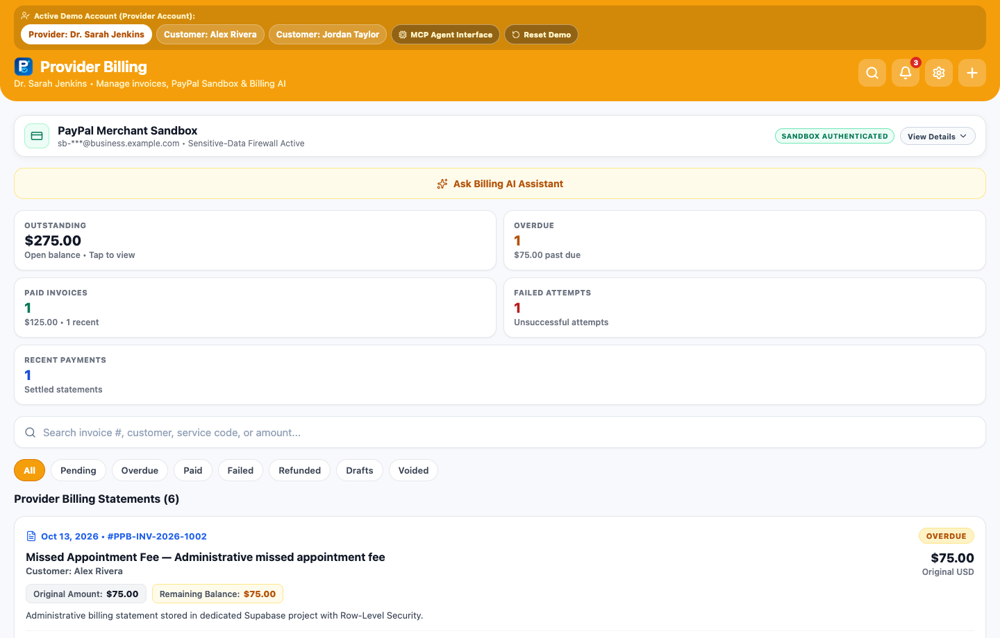 | 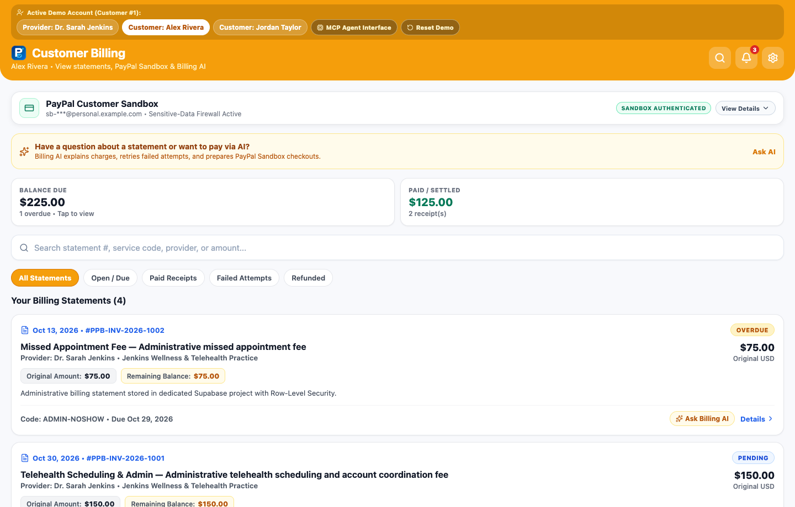 |

### Collapsible PayPal Merchant Sandbox Connection Card
| Compact Default State (`Show Details`) | Expanded Diagnostics & Firewall State (`Hide Details`) |
| :---: | :---: |
| 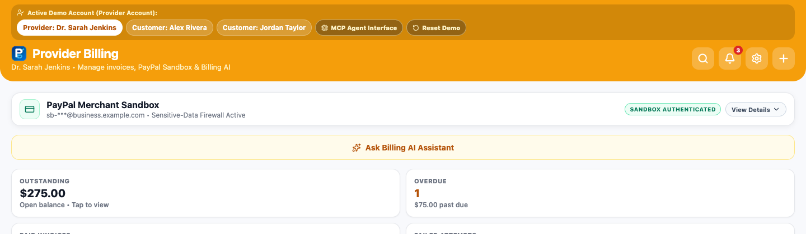 | 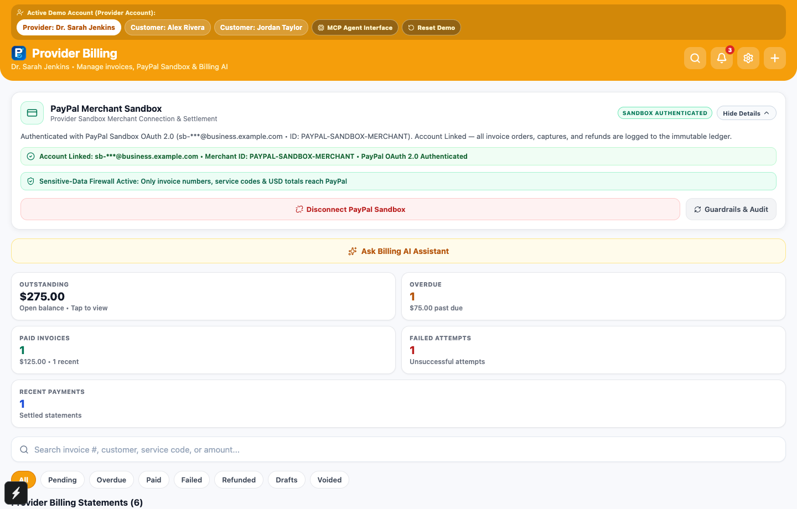 |

### Billing AI Assistant: Header `New Chat`, Invoice Q&A & Failed Payment Diagnosis
| Invoice Explanation & Header `New Chat` (`#PPB-INV-2026-1003`) | Failed Payment Investigation (`#PPB-INV-2026-1004`) |
| :---: | :---: |
| 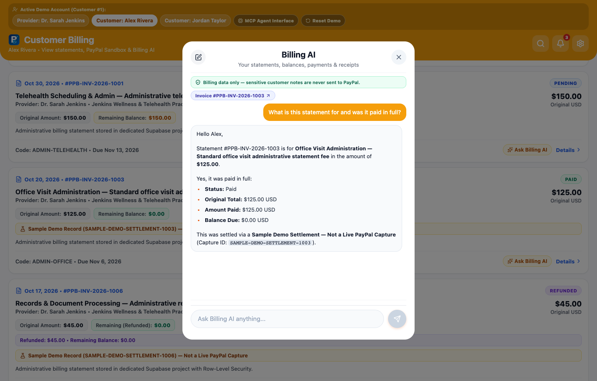 | 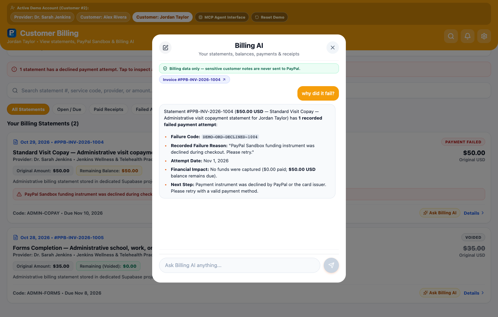 |

### Statement Details Modal, PayPal Sandbox Checkout & Verified Settlement Receipt
| Responsive Statement Details Modal (`Pay with PayPal`) | PayPal Sandbox Browser Checkout Interface (`appSwitchEligible=false`) | Settled Payment & Merchant-Branded Receipt (`View Receipt`) |
| :---: | :---: | :---: |
| 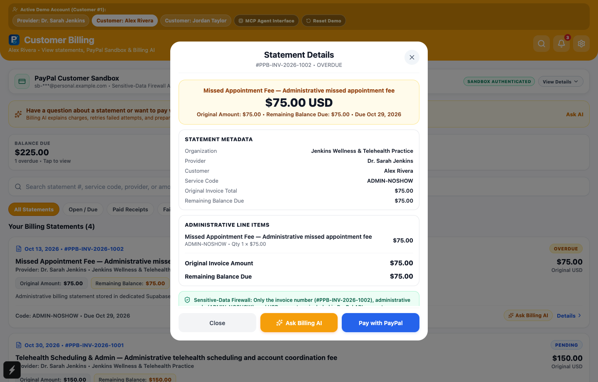 | 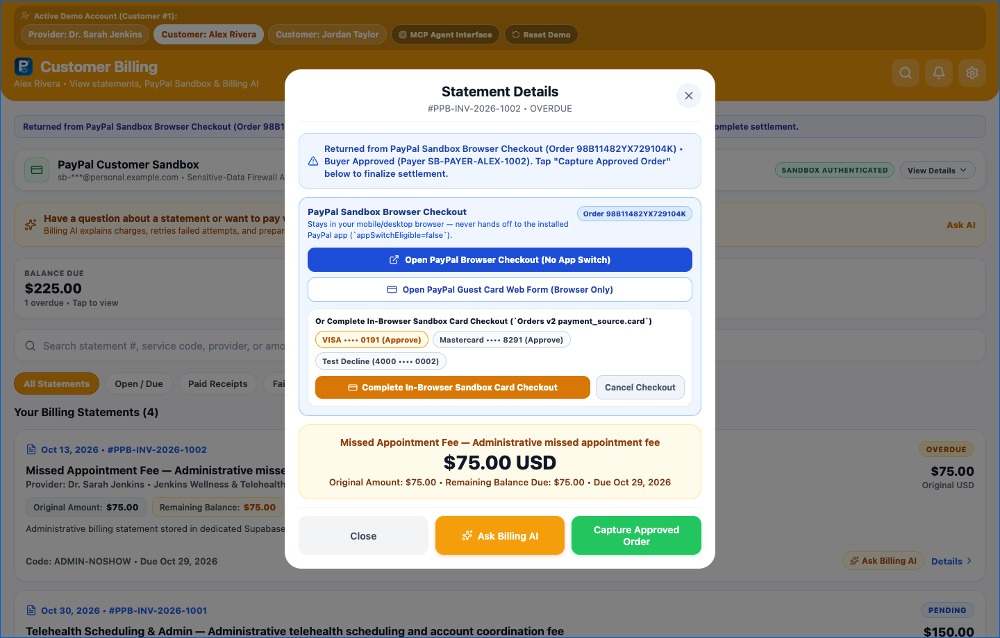 | 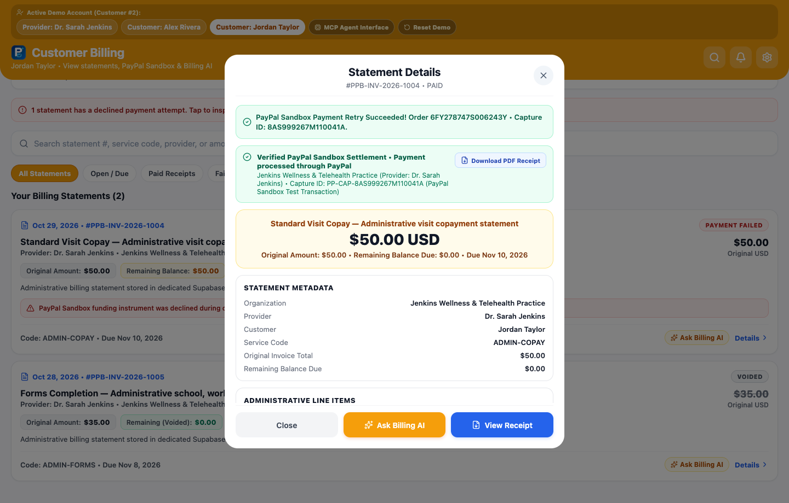 |

### Customer Notification Isolation, Global Search & Unified 82-Tool MCP Interface
| Customer Notification Isolation (`Jordan Taylor`) | Global Billing Search Modal | Unified 82-Tool MCP Agent Interface |
| :---: | :---: | :---: |
| 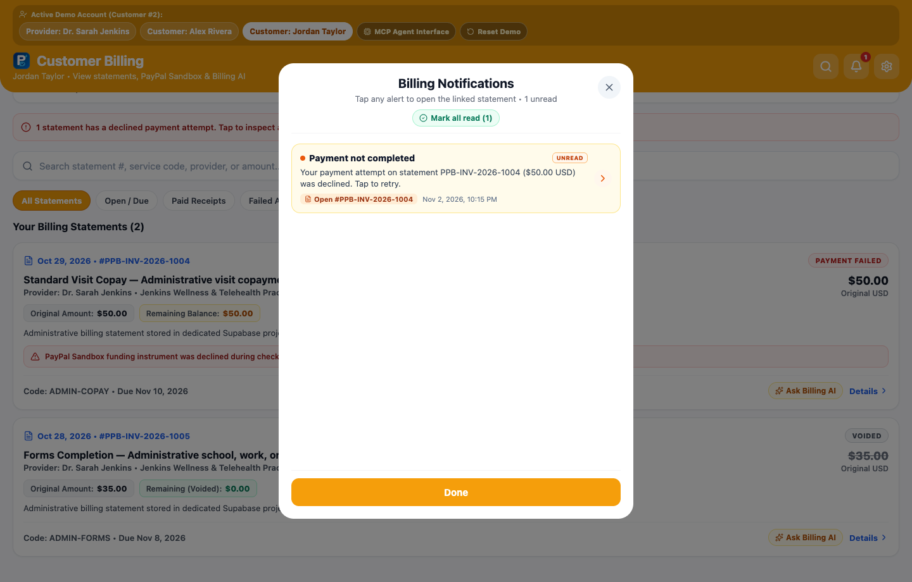 | 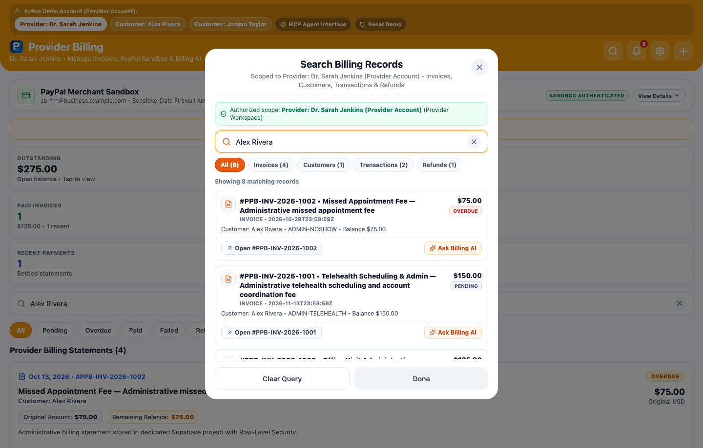 | 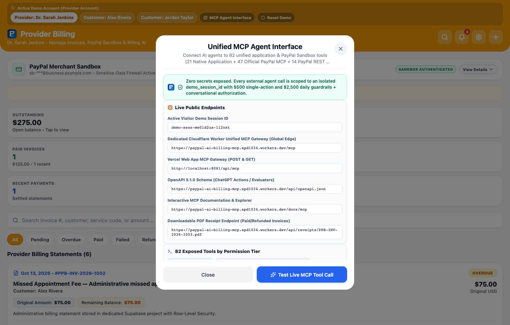 |

### Mobile Responsiveness (`390×844` Viewport)
| Mobile Dashboard (`390px`) | Mobile Billing AI & Combined Multi-Statement Proposal (`390px`) |
| :---: | :---: |
| 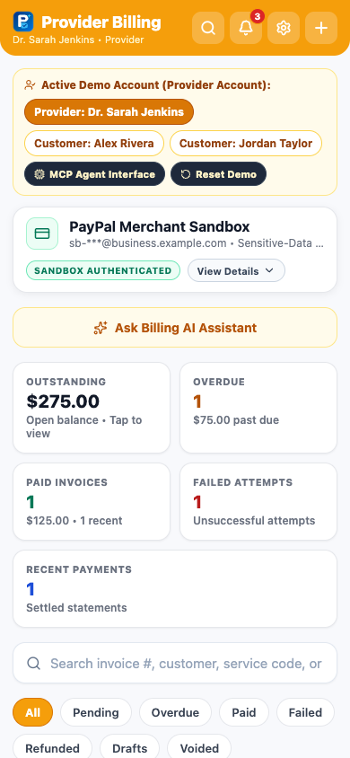 | 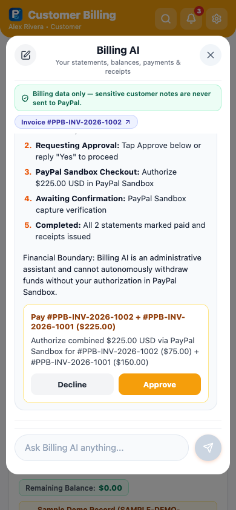 |

---

## 4. Architecture & Unified 82-Tool MCP Gateway

The **PayPal AI Billing Kit** exposes all **46 official PayPal Model Context Protocol (MCP) tools** alongside our native application workflows and REST adapters, forming a comprehensive 82-tool unified gateway. The gateway architecture (`worker/src/index.ts` and Supabase Edge Functions) registers every official PayPal MCP tool by its exact canonical name and executes transactions through a high-reliability **PayPal Sandbox REST v1/v2/v3 execution bridge** (`https://api-m.sandbox.paypal.com`) backed by server-side OAuth 2.0 client-credentials authentication (`APP-5SK74342S6474230W`), human-in-the-loop monetary guardrails, and real-time schema parity.

### Honest Execution Classification Across All 46 Official PayPal MCP Tools

Live individual verification (`npm run verify:full-paypal-mcp`, recorded in [`evidence/full-paypal-mcp-verification.json`](./evidence/full-paypal-mcp-verification.json)) establishes the exact operational breakdown:

| Verification Status | Tool Count | Meaning & Exact Tools |
| :--- | :--- | :--- |
| **`PASS_REST_ADAPTER` (Fully Executed Live on PayPal Sandbox)** | **`35` / 46** | **Full end-to-end live execution (`HTTP 200/201/204`) against `https://api-m.sandbox.paypal.com`:** `create_invoice`, `create_recurring_series`, `activate_recurring_series`, `get_recurring_series`, `cancel_recurring_series`, `delete_recurring_series`, `list_invoices`, `get_invoice`, `send_invoice`, `send_invoice_reminder`, `cancel_sent_invoice`, `delete_invoice`, `setup_invoice_auto_reminders`, `update_invoice_auto_reminder`, `search_invoicing`, `update_invoicing`, `cancel_invoice_auto_reminder`, `generate_invoice_qr_code`, `generate_invoice_number`, `record_payment_for_invoice`, `record_refund_for_invoice`, `create_product`, `list_products`, `update_product`, `show_product_details`, `create_subscription_plan`, `list_subscription_plans`, `show_subscription_plan_details`, `create_subscription`, `show_subscription_details`, `create_order`, `get_order`, `list_disputes`, `create_refund`, `get_refund`. |
| **`PASS_NEGATIVE_AUTHORIZATION` (Live Endpoint Reached; Buyer Approval or Active Dispute Required)** | **`5` / 46** | **Reaches live PayPal Sandbox API and returns structured domain-state validation:**<br>• `pay_order` (`422 ORDER_NOT_APPROVED` when attempting to capture a wallet order before buyer checkout approval; server-side card capture is supported via `execute_sandbox_card_payment`).<br>• `cancel_subscription` & `update_subscription` (`SUBSCRIPTION_APPROVAL_PENDING` on newly created `APPROVAL_PENDING` subscriptions prior to interactive buyer sign-off).<br>• `get_dispute` & `accept_dispute_claim` (`404 RESOURCE_NOT_FOUND` when no open buyer-initiated dispute exists in the Sandbox merchant queue). |
| **`BLOCKED_OAUTH_SCOPE` (Sandbox Default App OAuth Scope Restriction)** | **`4` / 46** | **Blocked by missing OAuth 2.0 scopes on PayPal Sandbox `Default Application` (`APP-5SK74342S6474230W`):**<br>• `create_shipment_tracking`, `get_shipment_tracking`, `update_shipment_tracking` (require `https://uri.paypal.com/services/shipping/trackers/readwrite`).<br>• `list_transactions` (requires `https://uri.paypal.com/services/reporting/search/read`; returns structured `PAYPAL_SANDBOX_OAUTH_SCOPE_RESTRICTED` diagnostic plus synchronized session transactions as fallback). |
| **`BLOCKED_UPSTREAM` (PayPal Sandbox Upstream Endpoint Error)** | **`1` / 46** | `create_conditional_rules_for_invoice`: PayPal Sandbox `/v2/invoicing/invoices/{id}/conditional-rules` returns upstream `500`/`422` in Sandbox environments. |
| **`UNSUPPORTED_BY_SANDBOX` (PayPal Sandbox Environment Limitation)** | **`1` / 46** | `get_merchant_insights`: Explicitly marked unsupported in PayPal Sandbox mode by `@paypal/agent-toolkit` (`GET /v1/merchant/insights`); returns structured diagnostic plus synchronized session business metrics. |

### Execution Summary Across All 14 PayPal Sandbox REST-to-MCP Adapters

- **`13` / 14 Fully Executed Live (`PASS_LIVE_SANDBOX` / `PASS_REST_ADAPTER`):** `execute_sandbox_card_payment`, `run_sandbox_card_lifecycle_test`, `paypal_get_order`, `paypal_get_refund`, `paypal_list_invoices`, `paypal_generate_invoice_number`, `paypal_list_disputes`, `paypal_check_card_eligibility`, `update_plan`, `paypal_list_webhooks`, `paypal_list_webhook_event_types`, `paypal_list_invoice_templates`, and `paypal_create_vault_setup_token`.
- **`1` / 14 Buyer-Approval Validated (`PASS_NEGATIVE_AUTHORIZATION`):** `paypal_authorize_order` (`POST /v2/checkout/orders/{id}/authorize` returns `422 ORDER_NOT_APPROVED` on an unapproved wallet order).

---

## 5. Security, Privacy & Customer Isolation Guardrails

1. **Human-in-the-Loop & Conversational Authorization (`require_human_approval = true`):**
   - Financial write operations require either a cryptographic HMAC-SHA256 `proposal_id` (`PPB-PROP-1...`) or an explicit natural-language `user_instruction` validated by `evaluateConversationalAuthorization`.
   - Capability inquiries (*"Can you refund an invoice?"*) and hypothetical questions (*"What would happen if I voided this?"*) return explanations or previews without mutating records.
2. **Monetary Velocity Guardrails (`$500.00` Single-Action / `$2,500.00` Rolling Daily Cap):**
   - Server-enforced across both the Gemini AI Assistant (`billing-ai-assistant`) and the Unified MCP Gateway (`worker/src/index.ts`). Any request exceeding `$500.00` (`50000` minor units) is blocked with `GUARDRAIL_SINGLE_ACTION_LIMIT_EXCEEDED`.
3. **Sensitive-Data Payload Firewall (`block_clinical_data = true`):**
   - Strips private notes and non-billing fields before any request reaches PayPal (`packages/paypal-billing-kit/src/firewall.ts`). Only allowlisted `ADMIN-*` service codes (`ADMIN-TELEHEALTH`, `ADMIN-COPAY`, `ADMIN-FORMS`, `ADMIN-OFFICE`, `ADMIN-NOSHOW`, `ADMIN-FOLLOWUP`), statement numbers, and USD amounts are transmitted to PayPal.
4. **Strict Customer Notification & AI Thread Isolation:**
   - Customer notification queries filter by both `recipient_profile_id` and linked statement `patient_id` so one customer never sees or opens another customer's statements or notifications.
   - Billing AI conversation threads are keyed by `(sessionId, accountKey, role, invoiceId)` and cleared immediately on demo reset or session switch.
5. **Zero Raw Card Credentials (`RAW_CARD_CREDENTIALS_FORBIDDEN`):**
   - Direct card checkout accepts only symbolic Sandbox test profile identifiers (`visa_sandbox`, `mastercard_sandbox`, `amex_sandbox`, `decline_refused`, `decline_expired`, `decline_insufficient_funds`) resolved server-side inside the Supabase Edge Function.

---

## 6. Local Development & Verification Suite

### Prerequisites
- **Node.js** `>= 20.x` & **npm**
- Optional environment variables for local Edge Function / Sandbox execution (never committed to Git):
  - `EXPO_PUBLIC_SUPABASE_URL` (`https://dvzfesfvefggnunkjhom.supabase.co`)
  - `EXPO_PUBLIC_SUPABASE_ANON_KEY` (public anon key)
  - Server-side Supabase Edge secrets: `PAYPAL_SANDBOX_CLIENT_ID`, `PAYPAL_SANDBOX_CLIENT_SECRET`, `GEMINI_API_KEY`

### Commands

```bash
# 1. Install dependencies
npm install

# 2. Start local Expo Web development server with HMR (http://localhost:8081)
npm run web

# 3. Static TypeScript verification (0 errors)
npm run typecheck

# 4. Run Jest unit & component tests (19 tests across 4 suites)
npm test -- --watchAll=false

# 5. Run local UI, Billing AI conversation & customer notification isolation suites
node scripts/verify-billing-notification-isolation.mjs
node scripts/verify-billing-ai-conversations.mjs
node scripts/verify-local-ui-and-ai-e2e.mjs

# 6. Verify all 82 Unified MCP Tools against live PayPal Sandbox
npm run verify:full-paypal-mcp

# 7. Run full 25-stage automated PayPal Sandbox, MCP, Card Lifecycle & Security verification
npm run verify:paypal-full

# 8. Verify all 82 Unified MCP Gateway tools across Cloudflare Worker + Supabase + Vercel
npm run verify:mcp

# 9. Verify Gemini 3.5 Flash-Lite AI, Proposal Security, Guardrails & Conversational Authorization
npm run verify:ai-security

# 10. Verify Gemini 3.5 Flash-Lite multi-turn thoughtSignature & 8 Merchant-Branded PDF Receipt cases
npm run verify:gemini-receipts

# 11. Run public repository hygiene & secret isolation scans
npm run verify:repo-hygiene
npm run scan:secrets
```

---

## 7. Demo Walkthrough Instructions (For Evaluators)

1. **Open the Application:** Open [`http://localhost:8081`](http://localhost:8081) locally (or [`https://paypal-ai-billing-kit.vercel.app`](https://paypal-ai-billing-kit.vercel.app)) — opens directly on the **Provider Billing** dashboard as **Dr. Sarah Jenkins** with zero login friction.
2. **Inspect the Collapsible PayPal Merchant Sandbox Card:** Click **`Show Details`** on the compact PayPal Merchant Sandbox card to inspect OAuth 2.0 status and the Sensitive-Data Firewall, then click **`Hide Details`**.
3. **Test Billing AI & Combined Multi-Statement Proposals (`Alex Rivera`):** Switch to **`Customer: Alex Rivera`**, open **Billing AI** on `#PPB-INV-2026-1002`, and ask:
   - `"Why do I owe $75 on invoice #PPB-INV-2026-1002 and when is it due?"`
   - `"Can I pay both open statements at the same time?"` (prepares a single combined `$225.00 USD` payment proposal covering `#PPB-INV-2026-1001` + `#PPB-INV-2026-1002`).
   - Click the **`New Chat`** icon in the upper-left corner of the modal header to start a fresh thread for the active invoice.
4. **Verify Customer Notification Isolation & Failed-Payment Recovery (`Jordan Taylor`):** Switch to **`Customer: Jordan Taylor`**, click the **Notifications (bell)** icon to verify Jordan sees only Jordan's own alerts (`#PPB-INV-2026-1004` & `#PPB-INV-2026-1006`), tap `#PPB-INV-2026-1004` to open **Statement Details**, and click **`Retry with PayPal`**. Watch the statement transition immediately to **`PAID`** (`$0.00` remaining balance) and the primary button change to **`View Receipt`**.
5. **Test the 82-Tool Unified MCP Agent Interface:** Click **`MCP Agent Interface`** in the top bar and click **`Test Live MCP Tool Call`** to run a live JSON-RPC 2.0 request.
6. **Reset Demo Session Anytime:** Click **`Reset Demo`** in the top bar to restore all 6 canonical statements, AI chats, and customer notifications.

---

## 8. Verifiable Test Results & Evidence Artifacts (`evidence/`)

| Verification Suite | Command | Result | Evidence File |
| :--- | :--- | :--- | :--- |
| **TypeScript & Jest Unit Suite** | `npm run typecheck && npm test -- --watchAll=false` | **`4/4` Suites, `19/19` Tests Passed** | [`evidence/03_unit_and_secret_scan_results.txt`](./evidence/03_unit_and_secret_scan_results.txt) |
| **Customer Notification Isolation Suite** | `node scripts/verify-billing-notification-isolation.mjs` | **`20/20` Assertions Passed** | `scripts/verify-billing-notification-isolation.mjs` |
| **Billing AI Conversation & Multi-Statement Suite** | `node scripts/verify-billing-ai-conversations.mjs` | **`33/33` Scenarios Passed** | [`evidence/billing-ai-conversation-verification.json`](./evidence/billing-ai-conversation-verification.json) |
| **Local UI & AI Playwright E2E Suite** | `node scripts/verify-local-ui-and-ai-e2e.mjs` | **`20/20` Checks Passed (`0` Console Errors)** | [`evidence/local-ui-and-ai-e2e-verification.json`](./evidence/local-ui-and-ai-e2e-verification.json) |
| **Full 82-Tool PayPal MCP & REST Adapter Verification** | `npm run verify:full-paypal-mcp` | **`82/82` Tools Verified (`0` Failures)** | [`evidence/full-paypal-mcp-verification.json`](./evidence/full-paypal-mcp-verification.json), [`evidence/rest-to-mcp-adapter-verification.json`](./evidence/rest-to-mcp-adapter-verification.json), [`evidence/mcp-cross-endpoint-parity.json`](./evidence/mcp-cross-endpoint-parity.json) |
| **Live 3-Endpoint MCP Protocol & Security Suite** | `npm run verify:mcp` | **`38/38` Checks Passed** | [`evidence/01_mcp_agent_interface_30_tools_checks.txt`](./evidence/01_mcp_agent_interface_30_tools_checks.txt) |
| **Gemini 3.5 Flash-Lite AI & Conversational Security** | `npm run verify:ai-security` | **`25/25` Checks Passed** | [`evidence/02_gemini_ai_and_security_20_checks.txt`](./evidence/02_gemini_ai_and_security_20_checks.txt), [`evidence/05_gemini_3_5_flash_lite_migration.json`](./evidence/05_gemini_3_5_flash_lite_migration.json) |
| **25-Stage Live PayPal Sandbox End-to-End Proof** | `npm run verify:paypal-full` | **`25/25` Stages Passed** | [`evidence/live-paypal-sandbox-proof.json`](./evidence/live-paypal-sandbox-proof.json) |
| **Merchant-Branded PDF 1.4 Receipts Verification** | `npm run verify:gemini-receipts` | **`8/8` Cases Rendered + Unpaid Blocked** | [`evidence/06_merchant_branded_receipts_verification.json`](./evidence/06_merchant_branded_receipts_verification.json) |
| **Public Repo Hygiene & Secret Isolation Scans** | `npm run verify:repo-hygiene && npm run scan:secrets` | **`0` Private Assets, `0` Leaked Secrets** | `scripts/verify-public-repo-hygiene.mjs` |

See [`docs/UNIFIED_MCP_AND_SECURITY_ARCHITECTURE.md`](./docs/UNIFIED_MCP_AND_SECURITY_ARCHITECTURE.md), [`CHANGELOG.md`](./CHANGELOG.md), and [`evidence/README.md`](./evidence/README.md) for complete documentation.

---

## License

MIT License — see [`LICENSE`](./LICENSE).
