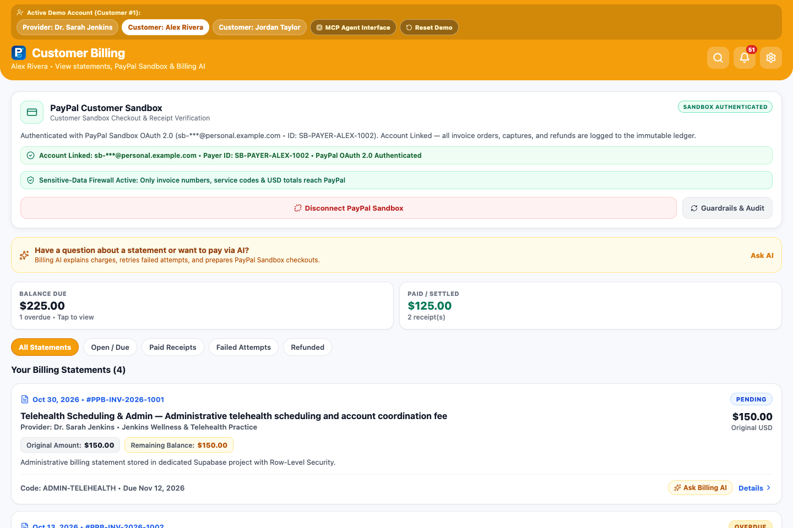
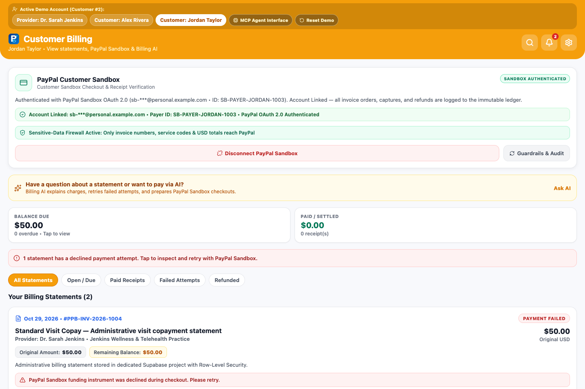
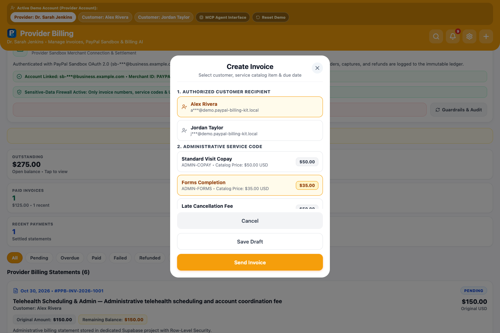
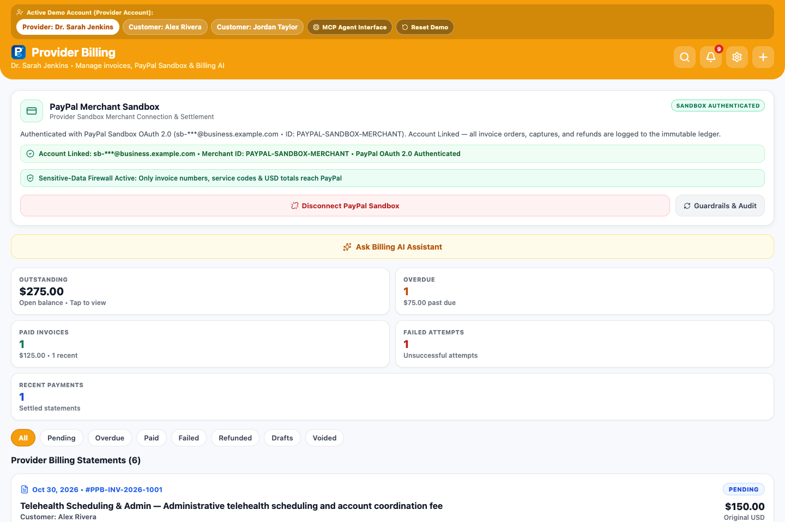
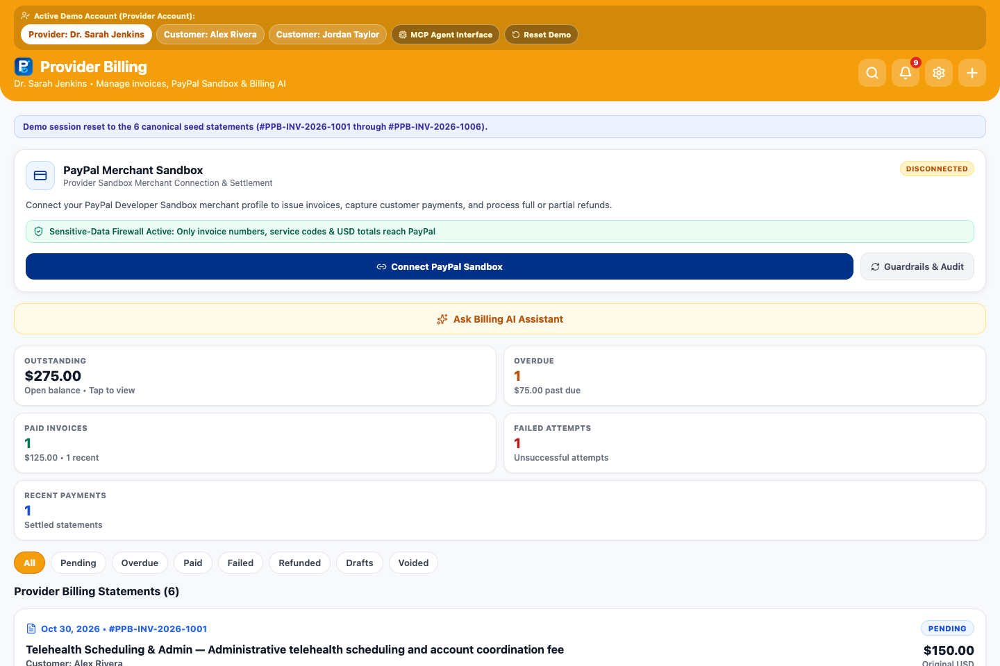
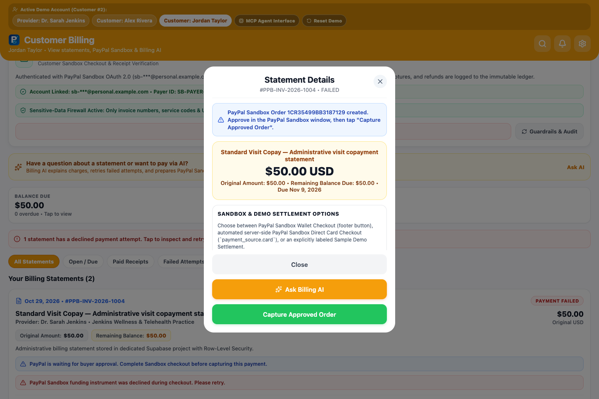
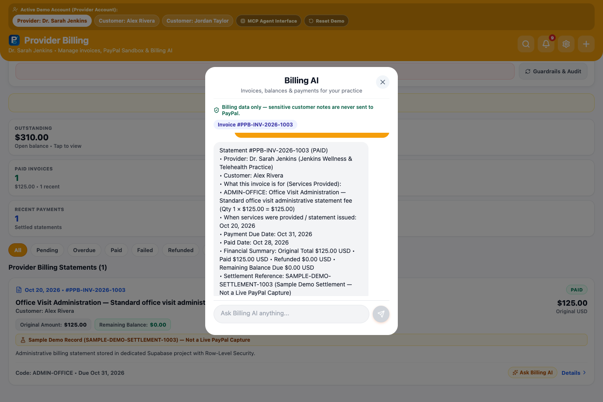
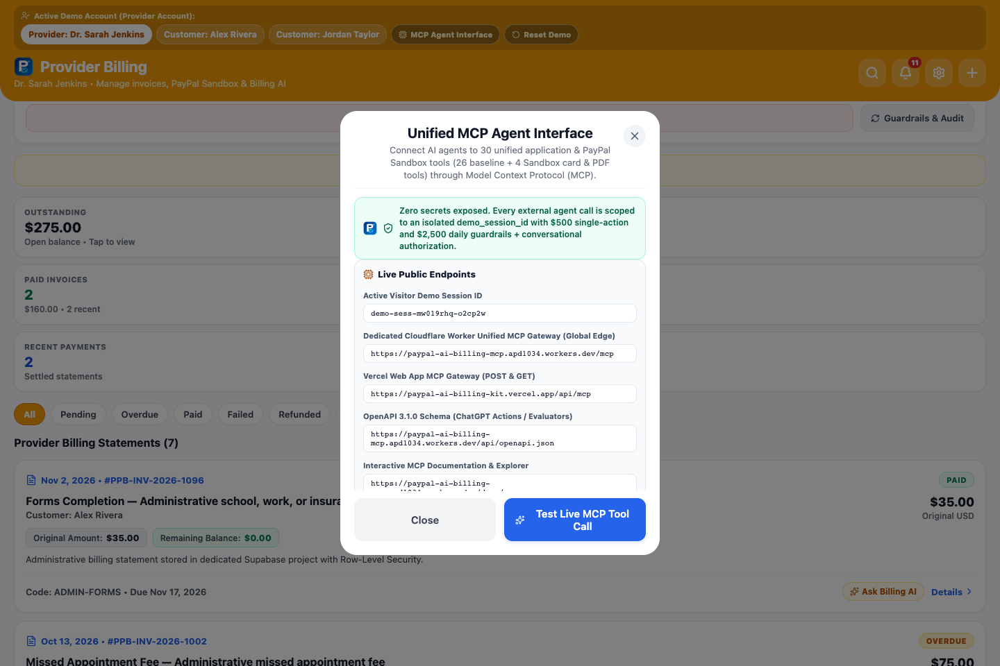
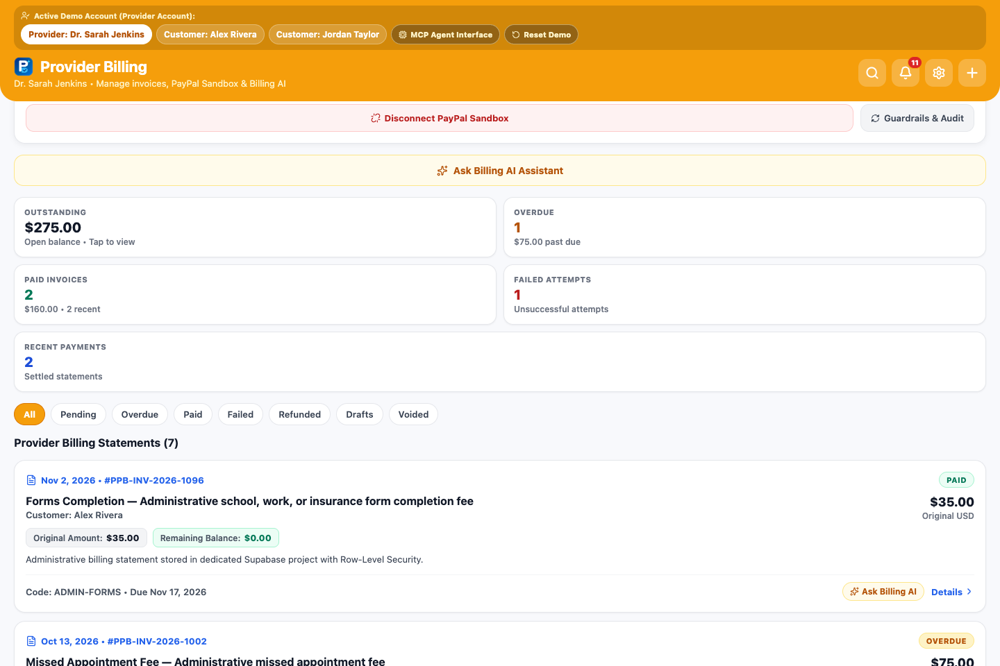

# PayPal AI Billing Kit (`v1.8.0`)

**AI-Powered Invoicing, Mistake-Recovery Workflows, Conversational Authorization, Automated Sandbox Card Checkout, Merchant-Branded PDF Receipts & Unified 30-Tool Model Context Protocol (MCP) Gateway for PayPal Sandbox.**

[](./LICENSE)
[](https://paypal-ai-billing-kit.vercel.app)
[](https://paypal-ai-billing-mcp.apd1034.workers.dev/mcp)
[](https://paypal-ai-billing-mcp.apd1034.workers.dev/api/openapi.json)

---

## Live Public Endpoints

| Endpoint | Public URL | Purpose |
| --- | --- | --- |
| **Web Application (Vercel)** | `https://paypal-ai-billing-kit.vercel.app` | Interactive Provider & Customer Billing Dashboard (Desktop & Mobile Web) |
| **Dedicated Unified MCP Gateway (Cloudflare Worker)** | `https://paypal-ai-billing-mcp.apd1034.workers.dev/mcp` | Primary JSON-RPC 2.0 MCP Server (`POST` & `GET`) exposing **30 unified tools** for ChatGPT MCP, Claude Desktop, and MCP Inspector |
| **Vercel MCP Mirror** | `https://paypal-ai-billing-kit.vercel.app/api/mcp` | Mirror JSON-RPC 2.0 MCP endpoint |
| **OpenAPI 3.1.0 Spec** | `https://paypal-ai-billing-mcp.apd1034.workers.dev/api/openapi.json` | Machine-readable OpenAPI 3.1.0 schema for ChatGPT Custom GPT Actions |
| **Interactive MCP Docs** | `https://paypal-ai-billing-mcp.apd1034.workers.dev/docs/mcp` | Human-readable MCP documentation and curl examples |
| **Downloadable PDF Receipt API** | `https://paypal-ai-billing-mcp.apd1034.workers.dev/api/receipts/PPB-INV-2026-1003.pdf` | Binary PDF 1.4 receipt download (`Content-Type: application/pdf`) |

---

## Overview

**PayPal AI Billing Kit** is a standalone, open-source AI billing and payment application built for the **PayPal AI Hackathon 2026**. It pairs a multi-role Billing Dashboard (**Provider** & **Customer** perspectives) with an in-app **Gemini 3.5 Flash-Lite Billing AI Assistant** (`thinkingLevel: "MEDIUM"`) and a **Unified 30-Tool Model Context Protocol (MCP) Gateway** connected to **PayPal Sandbox REST v2 APIs** (`api-m.sandbox.paypal.com`) and **Official PayPal MCP Discovery** (`mcp.sandbox.paypal.com/sse`).

### Key Capabilities

1. **Unified 30-Tool MCP Gateway (`https://paypal-ai-billing-mcp.apd1034.workers.dev/mcp`):**
   - **21 Native Application Tools:** Customer lookup, invoice search, balance explanation, transaction history, structured + PDF receipts (`get_payment_receipt`, `generate_receipt_pdf`), session-isolated audit logs, business metrics, proposal creation, real PayPal Sandbox wallet & card order creation/capture/refund, unpaid invoice voiding, and conversational command execution.
   - **1 Official PayPal MCP Discovery Tool (`paypal_discover_official_mcp`):** Live probe of PayPal's official remote MCP server (`mcp.sandbox.paypal.com/sse`), OAuth metadata, and 46-tool catalog.
   - **8 PayPal Sandbox REST Adapter Tools (`paypal_get_order`, `paypal_get_refund`, `paypal_list_invoices`, `paypal_generate_invoice_number`, `paypal_list_disputes`, `paypal_check_card_eligibility`, `execute_sandbox_card_payment`, `run_sandbox_card_lifecycle_test`):** Execute official PayPal MCP tool contracts and automated Sandbox card-payment workflows directly against `api-m.sandbox.paypal.com` with live Sandbox credentials.
2. **Automated Server-Side PayPal Sandbox Direct-Card Checkout (`Orders v2 payment_source.card`):**
   - Alongside standard PayPal Wallet Checkout (`PAYER_ACTION_REQUIRED` → buyer approval URL) and explicitly labeled Demo Settlement Simulation, supports server-side PayPal Sandbox card payments using allowlisted developer test card profiles (`visa_sandbox`, `mastercard_sandbox`, `amex_sandbox`, `decline_refused`, `decline_expired`, `decline_insufficient_funds`) for automated `Order → Capture → Receipt → Refund` verification without exposing or accepting raw card numbers (`RAW_CARD_CREDENTIALS_FORBIDDEN`).
3. **8-State Payment-Attempt Classification & Session-Isolated Audit Trail:**
   - Distinguishes `awaiting_buyer_approval`, `approval_required` (`ORDER_NOT_APPROVED`), `payment_declined`, `buyer_canceled`, `authorized`, `captured`, `refunded`, and `processing_error` so premature capture attempts never inflate declined-card metrics.
   - Enforces strict session and role isolation on `get_financial_audit_history` (`canonical_seed` vs `session_private`).
2. **Dual Authorization Model (Cryptographic Proposals + Conversational Authorization):**
   - **HMAC-SHA256 Proposal Tokens (`PPB-PROP-1...`):** Server-persisted in `public.billing_ai_action_proposals` with 30-minute expiration, parameter binding, and single-use consumption.
   - **Explicit Conversational Authorization (`evaluateConversationalAuthorization`):** Direct user instructions (e.g., *"Create a $35 invoice for Alex Rivera for immunization"*, *"Pay Alex Rivera's $35 invoice"*, *"Refund $20 on invoice PPB-INV-2026-1003"*, *"Void unpaid invoice PPB-INV-2026-1001"*) execute immediately within `$500` single-action and `$2,500` daily guardrails, while capability questions (*"Can you refund invoices?"*) and hypothetical questions (*"What would happen if I paid?"*) never trigger writes.
3. **Real End-to-End PayPal Sandbox Payments & Refunds:**
   - Creates real PayPal Sandbox Orders (`POST /v2/checkout/orders`), enforces genuine buyer approval on `sandbox.paypal.com`, captures payments (`POST /v2/checkout/orders/{id}/capture`), and executes partial or full refunds (`POST /v2/payments/captures/{id}/refund`).
4. **Professional Merchant-Branded PDF 1.4 Receipts:**
   - Generates merchant-first downloadable PDF receipts (`GET /api/receipts/:invoice_number.pdf`) and base64-encoded PDFs inside `get_payment_receipt` and `generate_receipt_pdf` featuring **Jenkins Wellness & Telehealth Practice** (`Provider: Dr. Sarah Jenkins`), distinct state titles (`Payment Receipt — Paid`, `Payment & Refund Receipt — Refunded`, `Payment Receipt — Partially Refunded`, `Sample Demo Receipt — Not a Real PayPal Payment`), PayPal Order/Capture/Refund IDs, card brand & last 4 digits, `"Payment processed through PayPal"` attribution, and `"This receipt was generated electronically. Please retain it for your records."` footer.

---

## Connecting ChatGPT MCP to PayPal AI Billing Kit

1. Open **ChatGPT** → **Settings** → **Connectors / Developer Mode (MCP)**.
2. Add a new MCP Server with:
   - **MCP Server URL:** `https://paypal-ai-billing-mcp.apd1034.workers.dev/mcp`
   - **Authentication:** None required for isolated visitor demo sessions (or OAuth 2.0 auto-discovered via `/.well-known/oauth-authorization-server`).
3. Refresh the connector and try these prompts directly in ChatGPT:

```text
Show me Alex Rivera's pending invoices.
Explain Jordan Taylor's failed payment.
Create a $35 invoice for Alex Rivera for immunization.
Prepare payment for Alex Rivera's $35 invoice.
Pay Alex Rivera's $35 invoice PPB-INV-2026-1002.
Give me the payment receipt and PDF download link for PPB-INV-2026-1003.
Refund $15 on invoice PPB-INV-2026-1003.
Inspect PayPal Sandbox order 4G312456A5669123W using paypal_get_order.
Show me the financial audit history.
```

---

## Application Walkthrough & Screenshots (`docs/screenshots/`)

### 1. Provider Dashboard & Connected PayPal Sandbox Status


### 2. Customer Perspectives (Alex Rivera & Jordan Taylor)
| Alex Rivera (Pending & Paid Invoices) | Jordan Taylor (Failed Payment & Recovery) |
| --- | --- |
|  |  |

### 3. Invoice Creation & PayPal Sandbox Connection Controls
| Create Invoice Modal | PayPal Sandbox Connected | PayPal Sandbox Disconnected |
| --- | --- | --- |
|  |  |  |

### 4. Failed Payment Recovery, Billing AI Assistant, Unified MCP Modal & Guardrails
| Failed Payment Retry (`#PPB-INV-2026-1004`) | Billing AI Assistant |
| --- | --- |
|  |  |

| Unified MCP Agent Interface (30 Tools) | Financial Guardrails & Audit Trail |
| --- | --- |
|  |  |

---

## Complete 30-Tool Unified MCP Reference (26 Baseline + 4 Sandbox Card & PDF Tools)

### Tier 1 — Read-Only Discovery, Receipts & PayPal Sandbox Inspection (18 Tools)
| Tool Name | Source | Description |
| --- | --- | --- |
| `discover_billing_capabilities` | `native_app` | Returns system capabilities, guardrails (`$500` single / `$2,500` daily), and tool catalog. |
| `list_demo_customers` | `native_app` | Lists fictional demo customers (`Alex Rivera`, `Jordan Taylor`) and provider (`Dr. Sarah Jenkins`). |
| `search_invoices` | `native_app` | Filters invoices by customer name, status (`sent`, `paid`, `partially_refunded`, `refunded`, `failed`, `void`), or query. |
| `get_invoice_details` | `native_app` | Returns full line-item breakdown, PayPal Order/Capture IDs, payment transactions, and refund history. |
| `explain_outstanding_balances` | `native_app` | Summarizes unpaid balances, overdue invoices, and failed payment recovery steps. |
| `get_transaction_history` | `native_app` | Lists PayPal Order creations, captures, refunds, and failure diagnostics. |
| `get_payment_receipt` | `native_app` | Generates a structured payment receipt plus downloadable PDF URL (`pdf_download_url`) and `pdf_base64`. |
| `generate_receipt_pdf` | `native_app` | Generates and validates a binary PDF 1.4 receipt for a paid or refunded statement (refuses unpaid invoices). |
| `get_financial_audit_history` | `native_app` | Lists session-isolated append-only audit entries from `billing_audit_events`. |
| `get_paypal_sandbox_status` | `native_app` | Verifies live PayPal Sandbox OAuth 2.0 connectivity and merchant connection status. |
| `get_business_metrics` | `native_app` | Computes total invoiced, collected, outstanding, refunded, and genuine failed payment metrics. |
| `paypal_discover_official_mcp` | `official_paypal_mcp` | Probes PayPal's official remote MCP server (`mcp.sandbox.paypal.com/sse`), OAuth metadata, and 46-tool catalog. |
| `paypal_get_order` | `paypal_rest_adapter` | Fetches a live PayPal Sandbox Order (`GET /v2/checkout/orders/{id}`). |
| `paypal_get_refund` | `paypal_rest_adapter` | Fetches a live PayPal Sandbox Refund (`GET /v2/payments/refunds/{id}`). |
| `paypal_list_invoices` | `paypal_rest_adapter` | Lists invoices from the PayPal Sandbox Invoicing v2 API (`GET /v2/invoicing/invoices`). |
| `paypal_generate_invoice_number` | `paypal_rest_adapter` | Generates the next PayPal Sandbox invoice number (`POST /v2/invoicing/generate-next-invoice-number`). |
| `paypal_list_disputes` | `paypal_rest_adapter` | Lists customer disputes from the PayPal Sandbox Disputes API (`GET /v1/customer/disputes`). |
| `paypal_check_card_eligibility` | `paypal_rest_adapter` | Checks merchant eligibility for PayPal Sandbox Orders v2 `payment_source.card` and lists safe test card profiles. |

### Tier 2 — Proposal-Only (3 Tools)
| Tool Name | Source | Description |
| --- | --- | --- |
| `create_invoice_proposal` | `native_app` | Validates guardrails and issues a signed `proposal_id` (`PPB-PROP-1...`) to create an invoice. |
| `prepare_payment_proposal` | `native_app` | Issues a signed `proposal_id` (`PPB-PROP-1...`) to initiate PayPal Sandbox checkout. |
| `prepare_refund_proposal` | `native_app` | Validates refundable balance and issues a signed `proposal_id` (`PPB-PROP-1...`) for a refund. |

### Tier 3 — Confirmed Financial Workflows, Sandbox Card Checkout & Conversational Writes (9 Tools)
| Tool Name | Source | Description |
| --- | --- | --- |
| `create_approved_invoice` | `native_app` | Persists a new invoice using either a signed `proposal_id` or an explicit `user_instruction`. |
| `create_paypal_checkout_order` | `native_app` | Creates a real PayPal Sandbox Order (`v2/checkout/orders`) and returns the `checkout_approval_url`. |
| `capture_paypal_checkout_order` | `native_app` | Captures an approved PayPal Sandbox Order (`v2/checkout/orders/{id}/capture`) and classifies `ORDER_NOT_APPROVED` as `approval_required`. |
| `execute_sandbox_card_payment` | `paypal_rest_adapter` | Executes a real server-side PayPal Sandbox card payment (`payment_source.card`) using allowlisted Sandbox card profiles. |
| `run_sandbox_card_lifecycle_test` | `paypal_rest_adapter` | Runs a complete isolated 7-step PayPal Sandbox card lifecycle test (`Invoice → Order → Capture → Verify → Receipt → Refund → Verify`). |
| `execute_approved_refund` | `native_app` | Executes a PayPal Sandbox Refund (`v2/payments/captures/{id}/refund`) via `proposal_id` or `user_instruction`. |
| `void_unpaid_invoice` | `native_app` | Voids an unpaid invoice (`draft`, `sent`, `overdue`, `failed`) via `proposal_id` or `user_instruction`. |
| `execute_conversational_instruction` | `native_app` | Evaluates a natural-language instruction with `evaluateConversationalAuthorization` and executes authorized actions. |
| `reset_demo_session` | `native_app` | Resets the caller's isolated `demo_session_id` back to the clean 6-invoice canonical baseline. |

---

## Local Setup & Verification Suite

```bash
# 1. Install dependencies
npm install

# 2. Run Jest unit tests (SDK, Conversational Auth, Unified MCP Registry, PDF Receipts)
npm test -- --watchAll=false

# 3. Run full 25-stage automated PayPal Sandbox, MCP, Card Lifecycle & Security verification
npm run verify:paypal-full

# 4. Verify all 30 Unified MCP Gateway tools against Cloudflare Worker + Supabase
npm run verify:mcp

# 5. Verify Gemini 2.5 Flash AI, Proposal Security, Guardrails & Conversational Authorization
npm run verify:ai-security

# 6. Run Playwright E2E browser verification against live Vercel deployment
npm run verify:e2e

# 7. Run secret & project isolation scan
npm run scan:secrets
```

See [`docs/UNIFIED_MCP_AND_SECURITY_ARCHITECTURE.md`](./docs/UNIFIED_MCP_AND_SECURITY_ARCHITECTURE.md) for the complete architectural and security specification.

---

## License

MIT License — see [`LICENSE`](./LICENSE).
